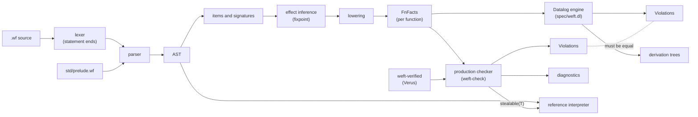
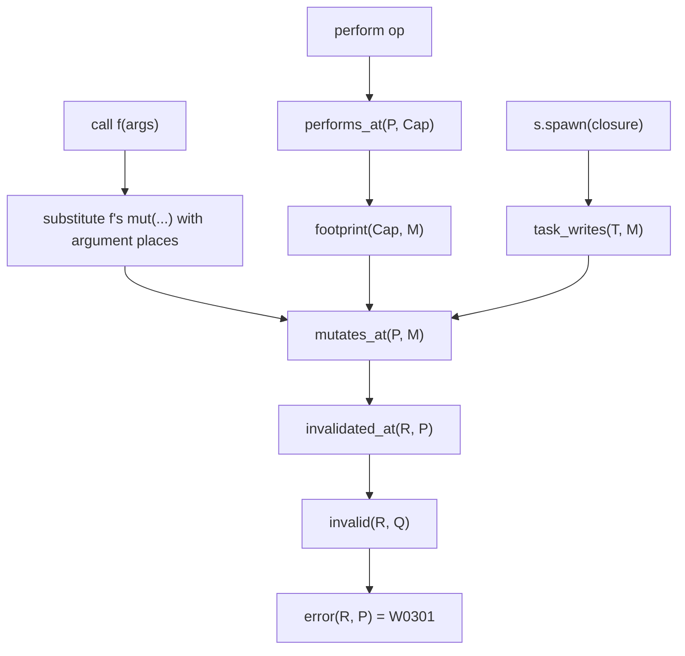

# Architecture

## Pipeline

## One mechanism for borrows and effects

## Effect inference

Sema infers the effects of each function that does not state them
(`crates/weft-sema/src/infer.rs`). A worklist lowers callees before callers. When a
signature grows, sema lowers again only the bodies that name that function. A new row
is joined with the old row, so a row only grows, and the lattice of rows is finite.
So the inference reaches a fixpoint. The bound for one row is the height of its
lattice (`infer::growth_limit`). A row that grows past it shows a checker bug: each
function whose row can still grow gets W0706, an error.

## Commands

| Command | Stages |
| --- | --- |
| `weft check` | load (file or package) → sema → checker → diagnostics; `--explain` adds the spec derivations |
| `weft agree` | load → sema → checker and spec → compare the violation sets |
| `weft run`, `weft test` | load → sema → checker → refuse on errors (unless `--unchecked`) → interpreter |
| `weft deps` | load → sema → dependency authority (W0901, W0902) |

A single file takes its options from marker lines: `// weft: library` and
`// weft: no-runtime`. A package takes them from `weft.toml`. The flags `--lib` and
`--bin`, `--no-runtime` and `--runtime` win over both. An unknown word in a marker
gets W0804, a warning.

## Size limits

The parser rejects nesting deeper than 96 levels and chains of more than about 150
prefix operators, postfix steps or `else if` branches. It keeps each part of 32 binary
operators of a long chain in a hidden local, so a flat chain has no limit. Sema and the
interpreter walk the tree recursively. `crates/weft-cli/tests/limits.rs` runs the
parser, the printer, sema, the checker, the spec and the interpreter on a 2 MiB thread
for the largest program that parses, also for chains inside nested blocks.

The derivation printer of `check --explain` (`weft_check::bridge::render_derivation`)
uses a stack, not recursion. It shows at most 32 levels of indent. A chain is a path of
premises whose relations depend on each other in the spec: `invalid` after `invalid`, or
`live_out` and `live_in` in turn. The printer folds a chain of more than 8 steps. It
shows the first 3 and the last 3 steps, and one line ``... N more `invalid` steps ...``.
So a path of 10 000 statements gives a few kilobytes of text. `limits.rs` tests this on
a 2 MiB thread for the derivations of W0301 and W0503.

`weft_cli::run` runs each command on a thread with a 256 MiB stack, as a margin. The
library entry points of sema and the checker (`weft_sema::analyze`,
`weft_check::check_source`) run on the stack of the caller. Their result holds `Rc`
values, so it cannot come back from another thread.

## Verified pieces

| Piece | Verified property | Used by |
| --- | --- | --- |
| `places::invalidates` | equals rule 3 (strict prefix, unstable step after it) | checker W0301 |
| `places::within` | inclusion; a cover invalidates at least as much | checker W0703, W0402; sema W0203, W0204 |
| `places::overlaps` | symmetric may-alias; split sides are disjoint | checker W0312, W0405 |
| `places::{step_alias, step_within, step_class}` | equal their spec functions; steps of different classes are not related | bridge (pairwise step facts) |
| `places::concat` | concatenation of paths | not yet used (sema substitutes places with its own code) |
| `dataflow::propagate` | result is exactly the least fixpoint of the gen/kill rules | every dataflow rule |
| `modes::{submode, join}` | partial order and least upper bound | not yet used (mode rules use flags in the facts) |
| `lifecycle::Continuation` | a `once` continuation resumes at most once | interpreter |
| `lifecycle::Linear` | a linear value is consumed or aborted at most once; a live value with no `on abort` does not unwind | interpreter |
