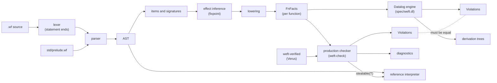
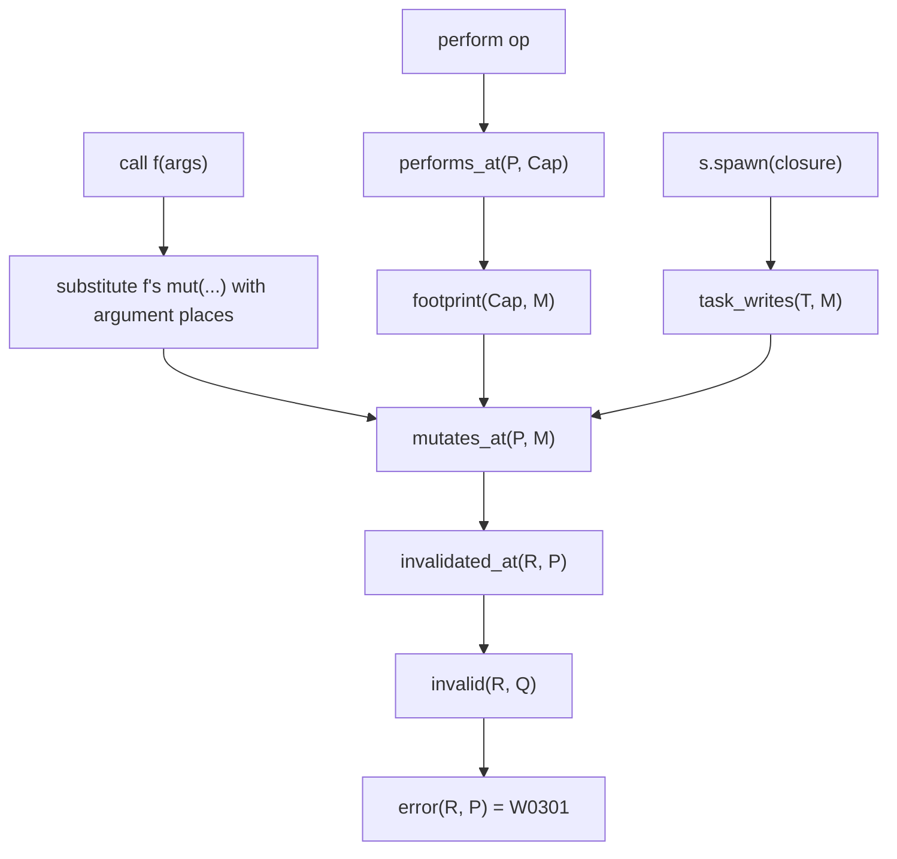

# Architecture

## Pipeline

## One mechanism for borrows and effects

## Effect inference

Sema infers the effects of each function that does not state them. It lowers every
such body again until no signature changes. The bound is `10 * (n + 2)` rounds for `n`
user functions (`weft_sema::round_limit`). If the signatures are not a fixpoint at the
bound, each function whose effects can still change gets W0706, an error.

## Commands

| Command | Stages |
| --- | --- |
| `weft check` | load (file or package) → sema → checker → diagnostics; `--explain` adds the spec derivations |
| `weft agree` | load → sema → checker and spec → compare the violation sets |
| `weft run`, `weft test` | load → sema → checker → refuse on errors (unless `--unchecked`) → interpreter |
| `weft deps` | load → sema → dependency authority (W0901, W0902) |

A single file takes its options from marker lines: `// weft: library` and
`// weft: no-runtime`. A package takes them from `weft.toml`. The flags add to them.

## Size limits

The parser rejects nesting deeper than 96 levels and chains of more than about 150
prefix operators, postfix steps or `else if` branches. It keeps each part of 32 binary
operators of a long chain in a hidden local, so a flat chain has no limit. Sema and the
interpreter walk the tree recursively. `crates/weft-cli/tests/limits.rs` runs each
stage on a 2 MiB thread for the largest program that parses.

## Verified pieces

| Piece | Verified property | Used by |
| --- | --- | --- |
| `places::invalidates` | equals rule 3 (strict prefix, unstable step after it) | checker W0301 |
| `places::within` | inclusion; a cover invalidates at least as much | checker W0703, W0402; sema W0203, W0204 |
| `places::overlaps` | symmetric may-alias; split sides are disjoint | checker W0312, W0405 |
| `places::{step_alias, step_within}` | equal their spec functions | bridge (pairwise step facts) |
| `places::concat` | concatenation of paths | not yet used (sema substitutes places with its own code) |
| `dataflow::propagate` | result is exactly the least fixpoint of the gen/kill rules | every dataflow rule |
| `modes::{submode, join}` | partial order and least upper bound | not yet used (mode rules use flags in the facts) |
| `lifecycle::Continuation` | a `once` continuation resumes at most once | interpreter |
| `lifecycle::Linear` | a linear value is consumed or aborted at most once | interpreter |
