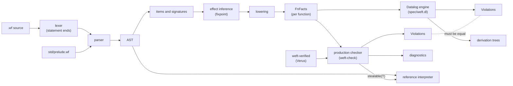
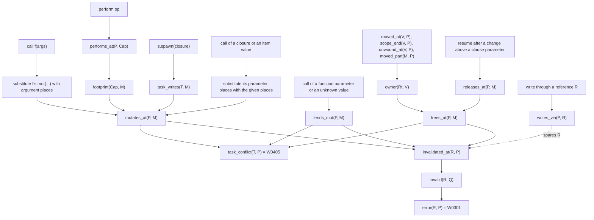
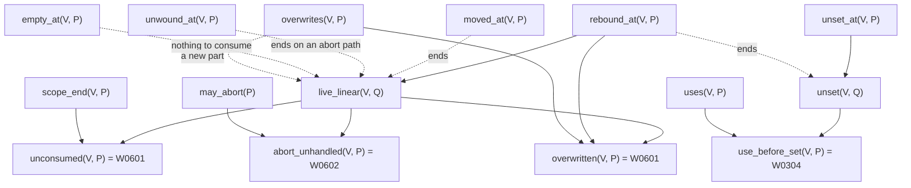

# Architecture

## Pipeline

## One mechanism for borrows and effects

## Linear values and values that are not set

A linear variable is live from a new value until a move. A new value with no linear
part, such as `None`, has nothing to consume (`empty_at`). A new value of a part makes
the variable live too. It must not be live where it goes out of scope or where it gets
a new value. A new value of a part drops the old value of the part too (`overwrites`).
An abort while it is live needs `on abort`. On the path of an abort to the end of a
`handle`, the unwinder finishes the values of the handled body (`unwound_at`). A `let`
can declare a variable with no value, and a place field can have no value. Each path
must give it a value before a use.

A mutation invalidates a reference only through an unstable step. A move or the end of
the owner frees the memory, so it invalidates every reference into the owned value. A
free or a mutation while a task is active must not overlap the task footprint.

A function value can mutate through its reference parameters. A call that knows the
value (a closure or an item, also one that a higher-order callee lends places to)
mutates the places that it gives. A call of a function parameter or of an unknown
value gives its places away: `lends_mut` invalidates references as a mutation does,
and the caller sees the real mutation. A lent place is also a `call_mut` of the call,
so it must not overlap another argument (W0312). See ADR 0005.

## Effect inference

Sema infers the effects of each function that does not state them
(`crates/weft-sema/src/infer.rs`). A worklist lowers callees before callers. When a
signature changes, sema lowers again only the bodies that name that function. A last
lowering of every body finds a read that the names do not show. A new row is joined
with the old row, so a row only grows, and the lattice of rows is finite. So the
inference reaches a fixpoint. The bound for one row is the height of its lattice
(`infer::growth_limit`). A row that grows past it shows a checker bug: the inference
stops, and each function whose signature can still change gets W0706, an error.

Each body, also one whose function states its effects, also infers the other parts of
its signature:

- What it lends to its function parameters.
- What its returned function value does, and the places of its parameters that the
  value points into.
- Which function parameters it stores.
- Whether it can run a stored function value, what it gives to that value, and
  whether it can run one more than once.
- Whether an unknown function value that it calls can resume more than once.
- Which parameters a task of the body can call.
- Which function parameters it gives to an operation of a handler of a caller, and
  what the values that it gives there perform.
- Which effects its tasks perform through a handler of a caller.
- Which function parameters it can call more than once.
- Which reference parameters can get a function value.
- Which parameters give references that it can put into an `rc` object.
- The type parameters of the values that it can drop or hold across an abort (ADR
  0007).

A new lowering replaces these parts, so they do not only grow. The parts of one
function can change at most 32 times and two more times for each function
(`infer::parts_limit`). After that, the inference keeps the last parts of that
function, and its callers use them. Its row can still grow. A function whose parts
still change at the end gets W0704, an error.

## Commands

| Command | Stages |
| --- | --- |
| `weft check` | load (file or package) → sema → checker and, for a package, dependency authority (W0901, W0902) → diagnostics; `--explain` adds the spec derivations |
| `weft agree` | load → sema → checker and spec → compare the violation sets |
| `weft run`, `weft test` | load → sema → checker → refuse on errors (unless `--unchecked`) → interpreter |
| `weft deps` | load → sema → dependency authority (W0901, W0902) |

`weft run` and `weft test` use the same checks as `weft check`, so an authority error of
a package also stops them. `weft deps` shows only the authority errors and the authority
of each dependency.

A single file takes its options from marker lines: `// weft: library` and
`// weft: no-runtime`. A package takes them from `weft.toml`. The flags `--lib` and
`--bin`, `--no-runtime` and `--runtime` win over both. An unknown word in a marker
gets W0804, a warning.

## Size limits

The parser rejects nesting deeper than 96 levels and chains of more than about 150
prefix operators, postfix steps or `else if` branches. It keeps each part of 32 binary
operators of a long chain in a hidden local, so a flat chain has no limit. Sema and the
interpreter walk the tree recursively. `crates/weft-cli/tests/limits.rs` runs the
parser, the printer, sema, the checker, the spec and the interpreter on a 2 MiB thread
for the largest program that parses, also for chains inside nested blocks.

The derivation printer of `check --explain` (`weft_check::bridge::render_derivation`)
uses a stack, not recursion. It shows at most 32 levels of indent. A chain is a path of
premises whose relations depend on each other in the spec: `invalid` after `invalid`, or
`live_out` and `live_in` in turn. The printer folds a chain of more than 8 steps. It
shows the first 3 and the last 3 steps, and one line ``... N more `invalid` steps ...``.
So a path of 10 000 statements gives a few kilobytes of text. `limits.rs` tests this on
a 2 MiB thread for the derivations of W0301 and W0503.

`weft_cli::run` runs each command on a thread with a 256 MiB stack, as a margin. The
library entry points of sema and the checker (`weft_sema::analyze`,
`weft_check::check_source`) run on the stack of the caller. Their result holds `Rc`
values, so it cannot come back from another thread.

## Verified pieces

| Piece | Verified property | Used by |
| --- | --- | --- |
| `places::invalidates` | equals rule 3 (strict prefix, unstable step after it) | checker W0301 |
| `places::within` | inclusion; a cover invalidates at least as much | checker W0703, W0402; sema W0203, W0204 |
| `places::overlaps` | symmetric may-alias; split sides are disjoint | checker W0312, W0405 |
| `places::{step_alias, step_within, step_class}` | equal their spec functions; steps of different classes are not related | bridge (pairwise step facts) |
| `places::concat` | concatenation of paths | not yet used (sema substitutes places with its own code) |
| `dataflow::propagate` | result is exactly the least fixpoint of the gen/kill rules | every dataflow rule |
| `modes::{submode, join}` | partial order and least upper bound | not yet used (mode rules use flags in the facts) |
| `lifecycle::Continuation` | a `once` continuation resumes at most once | interpreter |
| `lifecycle::Linear` | a linear value is consumed or aborted at most once; a live value with no `on abort` does not unwind | interpreter |
