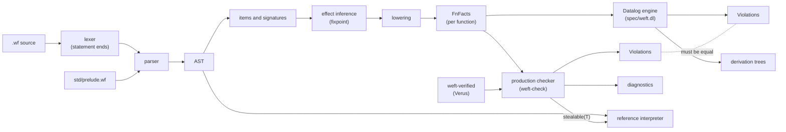
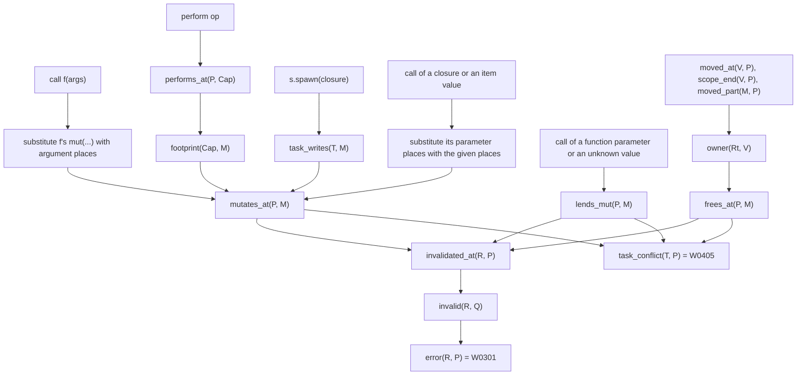

# Architecture

## Pipeline

## One mechanism for borrows and effects

A mutation invalidates a reference only through an unstable step. A move or the end of
the owner frees the memory, so it invalidates every reference into the owned value. A
free or a mutation while a task is active must not overlap the task footprint.

A function value can mutate through its reference parameters. A call that knows the
value (a closure or an item, also one that a higher-order callee lends places to)
mutates the places that it gives. A call of a function parameter or of an unknown
value gives its places away: `lends_mut` invalidates references as a mutation does,
and the caller sees the real mutation. A lent place is also a `call_mut` of the call,
so it must not overlap another argument (W0312). See ADR 0005.

## Verified pieces

| Piece | Verified property | Used by |
| --- | --- | --- |
| `places::invalidates` | equals rule 3 (strict prefix, unstable step after it) | checker W0301 |
| `places::within` | inclusion; a cover invalidates at least as much | checker W0703, W0402 |
| `places::overlaps` | symmetric may-alias; split sides are disjoint | checker W0312, W0405 |
| `dataflow::propagate` | result is exactly the least fixpoint of the gen/kill rules | every dataflow rule |
| `modes::{submode, join}` | partial order and least upper bound | mode checks |
| `lifecycle::Continuation` | a `once` continuation resumes at most once | interpreter |
| `lifecycle::Linear` | a linear value finishes once: consumed or aborted | interpreter |
