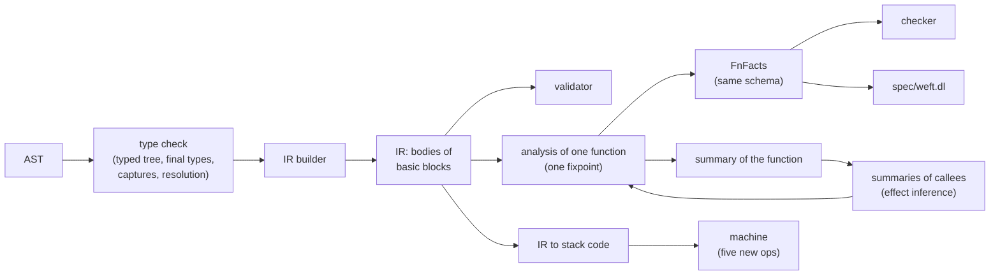

# Core IR design: a MIR-like control-flow graph

Status: design proposal (angle "MIR"). Date: 2026-10-20. Base: commit `b073ea7`, with the
R3a spec change of `/home/user/wt-core` commit `616f99c` (the input relation `rest_linear`
and the part-move rule of `invalidated_at`). Nothing in `/home/user/weft` changed.

Inputs: `docs/plan/core-ir-inputs/map_lowering.md` (the map, cited as "map 2.12"), `docs/plan/core-ir-inputs/root_causes.md` (the
classes, cited as "class ENV"), `docs/plan/core-ir-inputs/semantics.md` (the run-time rules, cited as
"sem 4.2"), `spec/weft.dl`, `crates/weft-facts`, ADR 0002 to 0011, `docs/design.md`,
`docs/architecture.md`, the B1, B3, B4, effects and link proofs, and the review reports of
rounds 1 to 3. Finding ids are the ids of `root_causes.md` (RT, F, OR, RR, FD, QA, IP, O3,
R3RT, F3, I3, Q3, OL-, V001 to V138). "Map N1" and "map N2" are the new findings of the map
(4.2). "Sem N1" to "sem N8" are the new findings of `semantics.md` (14).

## Summary

- The design puts a core IR between the typed tree and the facts. The IR is a CFG of basic
  blocks for each code unit: a function, a test, a closure, a handler clause, a handled
  body and a scope body. These are the six code units of the interpreter (`CodeKind`).
- The IR has places (a base and projections, with an explicit `Deref`), operands
  (`copy`, `move`, constants), rvalues, `StorageLive` and `StorageDead` for every local and
  temporary, and terminators: `Goto`, `SwitchInt`, `Call`, `Handle`, `Scope`, `ScopeWait`,
  `Assert`, `Return`, `UnwindResume` and `Unreachable`. One `Call` terminator serves items,
  function values, methods, performs, `resume` and the task built-ins.
- A closure is an aggregate of its environment (`&x`, `move x` or `copy x` for each
  capture) and a body of its own. A clause, a handled body and a scope body name the
  locals of the frame around them as upvars.
- Each terminator that can abort has an unwind action to a cleanup chain. Each terminator
  that can suspend to a handler with a `multi` operation has a re-entry block. Fact
  generation adds the abort edge and the re-entry edge when the summary of the callee says
  that the terminator can abort or resume more than once.
- A new type-check pass runs first and makes a typed tree with final types. So the builder
  knows copy or move, every implicit dereference, the order of named arguments and the
  capture mode of each closure capture.
- Fact generation is one rule for each statement kind and one rule for each terminator
  kind, over one dataflow fixpoint for each function. Handled bodies and scope bodies run
  once, so fact generation puts their CFG into the CFG of the frame around them (a splice).
  Closures and clauses are components of their own. One summary type and one apply
  procedure put their effects at each node that runs them. The same procedure applies
  the signature of a function item, the clauses at a perform, the handled body at a
  `resume`, a task at a spawn and an `on abort` function on a cleanup path.
- Fact variables: one storage variable for each local (moves, linear values, ends,
  owners), and one reference version for each definition of a part of a local that can hold
  a reference. The versions make `points_into` flow-sensitive with no change to the spec.
- The interpreter runs the IR: a new compiler from the IR to the existing stack code
  replaces `crates/weft-interp/src/compile.rs`. The machine stays, with five new
  instructions. So the checker and the interpreter read one set of decisions.
- Of the 180 unsound findings, the design removes 114 (63%) by construction, 11 more
  (class CAP) when the capability rules move into the spec (stage M9), 25 partly, and 30
  not at all. Of the 53 false positives: 33 by construction, 2 more at M9, 7 partly, 11 not
  at all. Section 5 lists each finding. The six new findings of the map and of
  `semantics.md` (map N1, N2, sem N1 to N4) go by construction.
- New finding of this design (M-new, 4.9): a clause that changes a place after `resume`.
  The `handle` gives out a reference that the body made after the operation. The checker
  accepts `ir/work/mir/postres.wf` at `b073ea7` and at `616f99c`, and the oracle faults.
  The design removes it: the part of a clause after its first resume point runs at an
  after-body node.
- What stays: function values across function boundaries (FNVAL, partly), the summary
  language for higher-order callees (SUM, partly), regions for references that function
  values keep (STORE), mode polymorphism (GEN), and the classes SPEC, TYPE, INF and NAMES.
- Migration: ten stages (M0 to M9). The old and the new fact generation run side by side.
  A diff gate runs both on the corpus (134 programs with R3a), the examples (46 files) and
  every probe of rounds 1 to 3 (56 932 files, unique by content: 3 661 hand-written and
  53 271 generated). An accepted program that faults under `--oracle` blocks a stage. Each other
  difference needs an entry in a ledger.
- Size: about 28 000 new lines (IR types 2 000, type check 5 000, builder 5 000, analysis
  3 000, summaries 2 500, facts 1 500, interpreter 1 600, gate 1 500, tests 2 500, proofs
  3 500). The design removes about 21 000 lines (`body/` and `compile.rs`). Effort: 14 to 18
  weeks for M0 to M8, and about 6 more for M9.

## 0. Decisions

Each decision has the alternatives that I looked at. An ADR (0012, "Core IR") records the
decisions D1 to D16. Decisions D3, D4, D5 and D9 change what a program does at run time or
which programs the checker accepts. They need their own ADR text.

| Id | Decision | Alternatives and why not |
| --- | --- | --- |
| D1 | A type-check pass makes a typed tree with final types before the IR. `Ty::Fn` carries no closure summary and no item. | Build the IR during inference and fix the types later: this keeps the class TYPES (V060) and the tentative moves (`settle_moves`). |
| D2 | One IR body for each code unit: function, test, closure, clause, handled body, scope body. | Inline the handled body and the scope body in the IR of the function: the interpreter runs them in frames of their own (sem 1.1), so the frame rules (temporaries, the value that leaves) need special cases again (O3-2, O3-3, F3-7). |
| D3 | An operand is read where it is written ("choice A" of sem 2.2). A copy operand goes into a temporary there. A non-copy operand of a comparison or of `print` is borrowed there. | Read at the operator ("choice B"): the IR must keep places in operands, and the facts must put the use at the operator. This keeps the shapes of sem N1 to N3 one rule away from a bug. Choice A is the MIR rule. It changes the output of programs such as `x + { x = 5; 1 }` (sem N8). |
| D4 | Temporaries: a temporary ends at the end of its statement. A block tail belongs to the statement around the block. The tail of a frame body moves into `_0`, then the temporaries and the locals of the frame end, then the frame returns. New: the tail temporaries of a loop body end at the end of each iteration. | Keep the loop rule of today (sem N5): temporaries pile up over the iterations. No checker reason needs it. |
| D5 | Capture rule for a closure: by move if the body moves the value (as today); by copy if the value is plain data and the function never assigns or borrows the variable after its declaration; else by reference. A clause, a handled body and a scope body use upvars and never copy. | Capture every non-moved variable by reference (cell capture of today): then a closure that captures only an integer cannot leave the scope, which the corpus and ADR 0003 allow (S012, V012, RR12). Keep "a copy cell outlives its scope": this is the split that made V125. |
| D6 | Fact generation splices a handled body and a scope body into the CFG of the frame around them. Closures and clauses are components with summaries. | Summaries for handled bodies too: they run once, at one node, so a summary only loses order. Call and return edges for closures (INNER, design (b)): a closure that runs at two nodes gets paths from one call to the other return. |
| D7 | One summary type (`BodySummary`) and one apply procedure for every node that runs code of another body. The 24 parts of `EffectSig` and the 42 fields of `Summary` become queries over the IR of the callee. | Keep `EffectSig` and `Summary` and port each part: this keeps the class SUM as it is. |
| D8 | Fact variables: one storage variable for each local, and one reference version for each definition of a move path that can hold a reference. A use of a local at a node uses the versions that reach the node. | One variable for each local, with part holders (today): `points_into` stays flow-insensitive (STATE: V069, OL-NR-flow, R3RT10). A flow-sensitive spec relation: a spec change that the versions make unneeded. |
| D9 | Every terminator that can abort by its kind has an unwind action to a cleanup chain of `Unwind` statements. The cleanup order is: newest value first in a frame, and the frames of a fresh continuation before the clause frame. Fact generation emits the abort edge only when the summary says that the terminator can abort. | The unwind order of the interpreter (reverse slot order, clause frame first, sem 7.3): it does not match the effects model (sem N6, N7). One order must win; the model order is the stack order. |
| D10 | A re-entry block after each terminator that can suspend to a handler with a `multi` operation, for a local handler and for a handler of a caller. | Only local handlers (today): a `multi` operation of a handler of a caller stays open (OL-R2a). |
| D11 | A capability is an operand. A perform names a capability value (a local handler) or the row (a handler of a caller). An item call lists the capability of each effect of the callee row. A closure captures the capabilities that it uses in its environment. | Implicit capabilities resolved in the fact generator: this keeps the hand-written channels of W0313 and W0314 (CAP). |
| D12 | A user `assert` is an `Assert` terminator with an unwind action. A bounds check, an overflow and a division by zero are traps with no unwind (the run stops, sem 7.1). | `assert` as a call of a print-like built-in: it is the gap of sem N4. |
| D13 | The interpreter runs the IR: a compiler from the IR to the existing stack code replaces `compile.rs`. Landing pads (the cleanup chains) come in a later stage. | A new IR interpreter: it repeats the machine (frames, effects, unwinder, scheduler) for no gain. Keep `compile.rs`: the IR is then a third lowering of the AST (class TWO stays). |
| D14 | No monomorphization. A generic body has one IR. A caller instantiates its summary. | Monomorphize before the check: exact, but one analysis for each instance. It is an option for later. |
| D15 | Parity first: the spec and the facts schema do not change before the switch (stage M8). After the switch, three optional moves into the spec: a sink relation of its own for W0204 at a return (before it, `diagnose.rs` shows `error(_0, ret)` as W0204, 4.8), W0313 (capability roots) and W0314 (a stack-bound mode). | Change the spec with the IR: then the diff gate cannot tell a fact bug from a rule change. |
| D16 | One fact node for each statement. A `Call` has two fact nodes: the call node and the return node, which binds the destination. A `Handle` and a `Scope` have a start node and a return node. | One node for each block: a use and a change in one block lose their order (A4). |

## 1. Pipeline and principles

### 1.1 Pipeline



- The type check runs once for each body. Effect inference does not change types, so the
  typed tree and the IR do not depend on effect inference.
- Effect inference (`infer.rs`) keeps its worklist. Each round runs the analysis and the
  fact generation of a function again with the new summaries of its callees. The IR does
  not change between rounds.
- The checker, the spec, the Datalog engine and the bridge do not change before stage
  M8. The diagnostics change in one place: an error of the return place at a `Return`
  node shows as W0204 for a function or a closure (4.8). The diagnostics read node labels
  and variable names from the facts, as today.

### 1.2 Principles

- **P1. One decision, one place.** The type check decides types, names, the order of
  arguments, implicit dereferences, copy or move, and capture modes. The builder decides
  order, temporaries, ends and cleanup. The analysis decides places, function values,
  tasks and capabilities. Fact generation only translates.
- **P2. The IR is the semantics.** The interpreter runs the IR. A rule that the IR does not
  state does not exist at run time either.
- **P3. Every value has a home.** Each intermediate value is a local with storage. No
  value is "on its way" without a local.
- **P4. One rule for each kind.** Fact generation has one rule for each statement kind,
  each terminator kind, each callee kind and each intrinsic. A surface form has no rule.
- **P5. One fixpoint.** The analysis of a function is one worklist fixpoint over its CFG.
  Loops are back edges. No pass lowers a body again. No pass adds a node after the
  fixpoint.
- **P6. The IR is fixed. Summaries vary.** The builder emits every edge that a kind of
  terminator can have. Fact generation keeps an abort edge or a re-entry edge only if the
  summaries say that it can occur.
- **P7. Precision through the domain, not through special cases.** A precision gain
  (one-place instances, `writes_via`, versions) is a property of the abstract domain or of
  the place shape. It is not a case of a surface form.

### 1.3 What the IR is not

- It is not a code-generation IR. It has no layout, no calling convention and no
  optimization.
- It does not replace the spec. The rules stay in `spec/weft.dl`. The IR changes how the
  input facts come about.
- It does not decide the abstract domain. Sections 4.4 and 4.6 define the domain. The
  choices there (widening, summary parts) are separate from the IR.

## 2. The IR as Rust types

### 2.1 Where the code goes

| Module | Content | Size (lines) |
| --- | --- | --- |
| `weft-sema/src/tc/` | The type check: inference, names, methods, operations, argument order, adjustments (auto-reference, dereference), capture analysis, exhaustiveness (W0120), W01xx, W0315. Output: the typed tree (`tc::Body`). | 5 000 (mostly moved out of `body/`) |
| `weft-sema/src/mir/ir.rs` | The types of this section. | 900 |
| `weft-sema/src/mir/build/` | The builder: typed tree to IR. | 5 000 |
| `weft-sema/src/mir/validate.rs` | The rules of 2.9. Runs in debug builds and in the gate. | 600 |
| `weft-sema/src/mir/pretty.rs` | The text form of 2.10 (`weft mir FILE FUNCTION`). | 500 |
| `weft-sema/src/mir/analysis/` | Move paths, the dataflow state, the fixpoint, widening (4.4). | 3 000 |
| `weft-sema/src/mir/summary/` | `BodySummary`, its computation and the apply procedure (4.6). | 2 500 |
| `weft-sema/src/mir/facts.rs` | The rules of 4.7 to 4.9. | 1 500 |
| `weft-interp/src/from_ir.rs` | The IR to stack code (6.2). Replaces `compile.rs`. | 1 200 |
| `weft-verified/src/factgen.rs` | The fact rules of the reference fragment, verified (7.5). | 500 |

The IR lives in `weft-sema`, because it needs `Ty` and the program tables, and
`weft-interp` already depends on `weft-sema`.

### 2.2 Ids and the function

```rust
//! The core IR of Weft (`weft_sema::mir`).
//!
//! The IR is a control-flow graph of basic blocks for each code unit. The type check
//! makes the typed tree. The builder makes the IR from it. Fact generation reads the IR.
//! The interpreter compiles the IR to its stack code. All types here are final: the IR
//! has no inference variables.

use std::rc::Rc;
use weft_syntax::ast::{BinOp, Span};
use crate::program::{AdtId, EffectId, FnId};
use crate::types::{IntTy, Ty};

/// A local of one body. `_0` is the return place. `_1` to `_n` are the parameters.
#[derive(Clone, Copy, Debug, PartialEq, Eq, Hash, PartialOrd, Ord)]
pub struct Local(pub u32);

/// The return place of a body.
pub const RETURN_PLACE: Local = Local(0);

/// A basic block of one body.
#[derive(Clone, Copy, Debug, PartialEq, Eq, Hash, PartialOrd, Ord)]
pub struct BlockId(pub u32);

/// A body of one function. `BodyId(0)` is the function body or the test body.
#[derive(Clone, Copy, Debug, PartialEq, Eq, Hash, PartialOrd, Ord)]
pub struct BodyId(pub u32);

/// An upvar of a body: a local of a frame around it that the body names.
#[derive(Clone, Copy, Debug, PartialEq, Eq, Hash, PartialOrd, Ord)]
pub struct UpvarIdx(pub u32);

/// A `handle` expression of the function.
#[derive(Clone, Copy, Debug, PartialEq, Eq, Hash, PartialOrd, Ord)]
pub struct HandlerIdx(pub u32);

/// A closure literal of the function.
#[derive(Clone, Copy, Debug, PartialEq, Eq, Hash, PartialOrd, Ord)]
pub struct ClosureIdx(pub u32);

/// A task site: a spawn or a branch of `fork`. Fact generation makes one `TaskId`
/// for each task site.
#[derive(Clone, Copy, Debug, PartialEq, Eq, Hash, PartialOrd, Ord)]
pub struct TaskSite(pub u32);

/// The index of an operation in its effect.
#[derive(Clone, Copy, Debug, PartialEq, Eq, Hash, PartialOrd, Ord)]
pub struct OpIdx(pub u32);

/// A point in a body: a statement, or the terminator when `index` is the number of
/// statements of the block.
#[derive(Clone, Copy, Debug, PartialEq, Eq, Hash, PartialOrd, Ord)]
pub struct Location {
    pub body: BodyId,
    pub block: BlockId,
    pub index: u32,
}

/// The IR of one function or test: its own body and every body inside it.
#[derive(Clone, Debug)]
pub struct FnIr {
    /// The function, or `None` for a test.
    pub item: Option<FnId>,
    /// The bodies. A body comes after the body that contains it.
    pub bodies: Vec<Body>,
    /// The `handle` expressions.
    pub handlers: Vec<HandlerDecl>,
    /// The closure literals.
    pub closures: Vec<ClosureDecl>,
    /// The task sites.
    pub tasks: Vec<TaskDecl>,
}
```

### 2.3 Bodies

```rust
/// One code unit. The interpreter runs each body in a frame of its own.
#[derive(Clone, Debug)]
pub struct Body {
    /// What the body is.
    pub kind: BodyKind,
    /// The body that contains this body, if any.
    pub parent: Option<BodyId>,
    /// The source of the body.
    pub span: Span,
    /// The locals. Index 0 is the return place, then the parameters.
    pub locals: Vec<LocalDecl>,
    /// The number of parameters.
    pub arg_count: u32,
    /// The locals of frames around this body that it names. Only a clause, a handled
    /// body and a scope body have upvars. A closure has an environment instead.
    pub upvars: Vec<UpvarDecl>,
    /// The blocks. `BlockId(0)` is the entry.
    pub blocks: Vec<BasicBlock>,
}

/// What a body is. The kinds are the `CodeKind`s of the interpreter.
#[derive(Clone, Copy, Debug, PartialEq, Eq)]
pub enum BodyKind {
    /// A function body. Its parameters are the parameters of the function.
    Fn,
    /// A `test` block. It has no parameters.
    Test,
    /// A closure body. `_1` is the environment: `&Env` for a closure that can run more
    /// than once, `Env` for a `once` closure. The closure parameters follow.
    Closure(ClosureIdx),
    /// A handler clause. The parameters are the arguments of the operation, then the
    /// continuation `resume`. It names the locals around its `handle` as upvars.
    Clause { handler: HandlerIdx, op: OpIdx },
    /// A handled body. `_1` is the capability of its handler. It runs once, at its
    /// `Handle` terminator.
    Handled(HandlerIdx),
    /// A scope body. `_1` is the scope capability. It runs once, at its `Scope`
    /// terminator. Its last terminator before `Return` is `ScopeWait`.
    ScopeBody,
}

/// A local of a body.
#[derive(Clone, Debug)]
pub struct LocalDecl {
    /// The final type.
    pub ty: Ty,
    /// Where the local comes from. Diagnostics use it.
    pub origin: LocalOrigin,
    /// The source of the local.
    pub span: Span,
    /// The properties of the type (`props.rs`), computed once.
    pub props: TyProps,
}

/// Where a local comes from.
#[derive(Clone, Debug, PartialEq, Eq)]
pub enum LocalOrigin {
    /// The return place `_0`.
    Return,
    /// A parameter that the source names.
    Param { name: Rc<str> },
    /// A local that a pattern binds. `unset` is true for `let x: T` with no value.
    User { name: Rc<str>, unset: bool },
    /// The environment of a closure body (`_1`).
    Env,
    /// The capability of a handled body (`_1`).
    Capability(HandlerIdx),
    /// The scope capability of a scope body (`_1`). The name is the binder.
    ScopeCap { name: Rc<str> },
    /// The continuation of a clause (`resume`).
    Continuation,
    /// The hidden iterator of a `for` loop.
    Iterator,
    /// A temporary.
    Temp(TempKind),
}

/// Why the builder made a temporary. Diagnostics show it ("the temporary of the
/// argument `v`").
#[derive(Clone, Copy, Debug, PartialEq, Eq)]
pub enum TempKind {
    /// An operand of a call, an operator, an aggregate or `print`.
    Operand,
    /// A receiver that is not a place.
    Receiver,
    /// A value that `&e` borrows.
    Borrowed,
    /// A `match` scrutinee that is not a place.
    Scrutinee,
    /// The value of an expression statement, of `let _ = e`, of a block statement or of
    /// a loop body: it goes away.
    Discarded,
    /// The condition of `if` or `while`.
    Condition,
    /// The result of a call.
    CallResult,
    /// The value of a block, an `if`, a `match`, a `handle` or a `scope`.
    Value,
    /// An index, a length or a bounds test.
    Index,
    /// The value of a callee that the call reads before its arguments.
    Callee,
}

/// The properties of a type that the IR and the facts use.
#[derive(Clone, Copy, Debug, Default, PartialEq, Eq)]
pub struct TyProps {
    /// A read copies the value (plain data). Else a read moves it.
    pub copy: bool,
    /// The value is linear.
    pub linear: bool,
    /// Each linear part has `on abort` (ADR 0007).
    pub has_on_abort: bool,
    /// The type is `!Move`.
    pub immovable: bool,
    /// The value cannot cross threads.
    pub nonportable: bool,
    /// The value is not `many` (a `multi` resume cannot copy it).
    pub once: bool,
    /// The value is `@ uniq`.
    pub uniq: bool,
    /// The value can hold a reference, a function value, a capability or a task.
    pub holds_refs: bool,
    /// The type names a type parameter of the function.
    pub generic: bool,
}

/// An upvar: a place of a frame around the body.
#[derive(Clone, Debug)]
pub struct UpvarDecl {
    /// The name, for diagnostics.
    pub name: Rc<str>,
    /// The local or the upvar of the parent body.
    pub outer: Base,
    /// The type.
    pub ty: Ty,
}
```

### 2.4 Places, operands and rvalues

```rust
/// A place: a base and a list of projections.
#[derive(Clone, Debug, PartialEq, Eq, Hash)]
pub struct Place {
    pub base: Base,
    pub proj: Vec<Proj>,
}

/// The base of a place.
#[derive(Clone, Copy, Debug, PartialEq, Eq, Hash)]
pub enum Base {
    /// A local of this body.
    Local(Local),
    /// A local of a frame around this body (a clause, a handled body, a scope body).
    Upvar(UpvarIdx),
}

/// One step of a place. The type of the place before the step decides the stability of
/// the step (ADR 0003). `Place::ty(body)` computes the type of each prefix from the type
/// of the base, as `PlaceTy` does in rustc.
#[derive(Clone, Copy, Debug, PartialEq, Eq, Hash)]
pub enum Proj {
    /// A field of a struct or a part of a tuple. Stable.
    Field(u32),
    /// The payload of a variant. Unstable. Valid only on a path where the
    /// discriminant is this variant.
    Downcast(u32),
    /// One element. The index is in a local. The container type declares the
    /// stability (`extern type Vec<T> { elem: unstable }`).
    Index(Local),
    /// All elements, as in `&v[]` and in `for e in v[]`.
    Elems,
    /// Follow a pointer.
    Deref(Ptr),
}

/// The kind of pointer that a `Deref` follows.
#[derive(Clone, Copy, Debug, PartialEq, Eq, Hash)]
pub enum Ptr {
    /// A reference `&T`. The place after it is a place of what the reference points
    /// into. A `Deref` reads the reference.
    Ref,
    /// A `Box<T>`. The target is owned in the same root, behind an unstable step.
    Box,
    /// An `Rc<T>`. The target is in the group root of `T`. A reference through it also
    /// depends on the handle place (ADR 0003).
    Rc,
}

/// An operand: a value that a statement or a terminator reads where it runs.
#[derive(Clone, Debug, PartialEq)]
pub enum Operand {
    /// Read the place and keep it: plain data.
    Copy(Place),
    /// Read the place and leave no value there.
    Move(Place),
    /// A constant.
    Const(Const),
}

/// A constant.
#[derive(Clone, Debug, PartialEq)]
pub enum Const {
    Unit,
    Bool(bool),
    Int(i64, IntTy),
    Str(Rc<str>),
    /// A duration in milliseconds.
    Duration(u64),
    /// A function item as a value, with its type arguments.
    Fn(FnId, Vec<Ty>),
    /// A variant with no payload, such as `None`. It has no linear part.
    UnitVariant(AdtId, u32),
}

/// The right side of an assignment.
#[derive(Clone, Debug, PartialEq)]
pub enum Rvalue {
    /// The value of an operand.
    Use(Operand),
    /// A reference to a place: `&p`, or `&v[]` with `Proj::Elems`.
    Ref(Place),
    /// An arithmetic or comparison operator. The integer type is the type of the result:
    /// the interpreter checks that the result fits (this replaces `FnFacts::int_ops`).
    Binary(BinOp, Operand, Operand, Option<IntTy>),
    /// `-a` or `!a`.
    Unary(UnOp, Operand, Option<IntTy>),
    /// The length of a container. It reads the length and the buffer (ADR 0006).
    Len(Place),
    /// The discriminant of an enum value. It reads the place.
    Discriminant(Place),
    /// A tuple, an array, a struct, a variant or a closure.
    Aggregate(AggKind, Vec<Operand>),
    /// A string interpolation: the text of each operand, joined.
    Concat(Vec<Operand>),
}

/// A unary operator.
#[derive(Clone, Copy, Debug, PartialEq, Eq)]
pub enum UnOp {
    Neg,
    Not,
    /// The text of a value, for an interpolation.
    Display,
}

/// The kind of an aggregate.
#[derive(Clone, Debug, PartialEq)]
pub enum AggKind {
    Tuple,
    /// An array or a `Vec` literal of the element type.
    Array(Ty),
    /// A struct. `fields[i]` is the field of operand `i` (written order, ADR 0009).
    /// `unset` are the place fields with no value (W0304): their move paths start
    /// uninitialized.
    Struct { adt: AdtId, fields: Vec<u32>, unset: Vec<u32> },
    /// A variant with a payload.
    Variant { adt: AdtId, variant: u32 },
    /// A closure. Operand `i` is environment field `i` of the closure (2.6).
    Closure(ClosureIdx),
}
```

### 2.5 Statements and terminators

```rust
/// A basic block: statements, then one terminator.
#[derive(Clone, Debug)]
pub struct BasicBlock {
    pub statements: Vec<Statement>,
    pub terminator: Terminator,
    /// The block is on a cleanup path. Only unwind actions lead here.
    pub cleanup: bool,
}

/// A statement and its source.
#[derive(Clone, Debug)]
pub struct Statement {
    pub kind: StmtKind,
    pub src: SourceInfo,
}

/// The kinds of statement. Each kind has one rule in fact generation (4.7) and one
/// rule in the compiler to stack code (6.2).
#[derive(Clone, Debug)]
pub enum StmtKind {
    /// The local gets storage. It has no value yet.
    StorageLive(Local),
    /// The value of the local goes away (its parts that still have a value), then its
    /// storage ends. This is the only drop on a normal path.
    StorageDead(Local),
    /// Write the value of the rvalue into the place. The rvalue reads its operands
    /// first. `Store` drops the old value of the place; `Init` writes a place with no
    /// value (the first value of a local after `StorageLive`).
    Assign(Place, Rvalue, AssignKind),
    /// A place in statement position: it names the place, reads nothing and moves
    /// nothing (ADR 0003). Its index operands ran before.
    PlaceMention(Place),
    /// A destructuring by value has moved every part out of the place: a linear struct
    /// is finished (consumed). Also an arm that matches a variant with no linear part
    /// on a linear local (ADR 0007).
    Consume(Place),
    /// A task handle in statement position goes to its scope. The scope joins the task
    /// and drops its result (ADR 0006).
    ScopeAdopt(Operand),
    /// Cleanup only: the unwinder finishes the value of the local. For a linear value
    /// it runs `on abort` (the function, if the type has one). Then the storage ends.
    Unwind(Local),
    /// Re-entry only: a `multi` resume gives each listed local a copy of the value
    /// that it had at the suspension point (ADR 0005).
    Recopy(Vec<Local>),
    /// Nothing.
    Nop,
}

/// How an assignment treats the old value of its place.
#[derive(Clone, Copy, Debug, PartialEq, Eq)]
pub enum AssignKind {
    /// The place has no value: a `let` binding, a temporary, a return place.
    Init,
    /// The place can have a value. The store drops it (`x = v`, `p.f = v`, `x += v`).
    Store,
}

/// A terminator and its source.
#[derive(Clone, Debug)]
pub struct Terminator {
    pub kind: TermKind,
    pub src: SourceInfo,
}

/// The kinds of terminator.
#[derive(Clone, Debug)]
pub enum TermKind {
    /// Go to a block. `back` is true on a loop back edge (the machine can preempt).
    Goto { target: BlockId, back: bool },
    /// Go to the block of the value of `discr` (a `bool` or a discriminant).
    SwitchInt { discr: Operand, arms: Vec<(i128, BlockId)>, otherwise: BlockId },
    /// Return `_0` to the frame below. The storage of every local has ended before.
    Return,
    /// Control cannot reach this point (after a call that does not return).
    Unreachable,
    /// The end of a cleanup chain: the unwinding goes on in the frame below.
    UnwindResume,
    /// Test `cond`. `User` aborts the task on failure (an `assert`). The other kinds
    /// stop the run with a fault (a trap): they must have `UnwindAction::None`.
    Assert { cond: Operand, kind: AssertKind, target: BlockId, unwind: UnwindAction },
    /// A call of any kind (2.6).
    Call(Box<Call>),
    /// Install a handler and run its handled body (2.7).
    Handle(Box<HandleTerm>),
    /// Make a scope and run its body.
    Scope(Box<ScopeTerm>),
    /// In a scope body only: wait for the children of the scope. A failure of a child
    /// becomes a `fail` with the handlers of the scope (sem 9.1).
    ScopeWait { target: BlockId, unwind: UnwindAction },
}

/// The kind of an `Assert`.
#[derive(Clone, Copy, Debug, PartialEq, Eq)]
pub enum AssertKind {
    /// A user `assert`: a failure aborts the task and unwinds it (sem 7.1).
    User,
    /// An index out of bounds: a fault.
    Bounds,
    /// A result that does not fit its integer type: a fault.
    Overflow,
    /// A division or a remainder by zero: a fault.
    DivZero,
}

/// Where control goes if the terminator aborts.
#[derive(Clone, Copy, Debug, PartialEq, Eq)]
pub enum UnwindAction {
    /// The kind of terminator cannot abort.
    None,
    /// Run this cleanup block.
    Cleanup(BlockId),
    /// Nothing to finish in this frame: the unwinding goes to the frame below.
    Resume,
}
```

### 2.6 Calls, callees, capabilities and closures

```rust
/// A call. The operands are read at the call, in order. The destination gets the
/// result at the return point, after the call (D16).
#[derive(Clone, Debug)]
pub struct Call {
    pub callee: Callee,
    /// The arguments in the order of the parameters (the type check orders named
    /// arguments, ADR 0009).
    pub args: Vec<CallArg>,
    /// The capability for each effect of the row of the callee (D11).
    pub caps: Vec<CapArg>,
    /// The place that gets the result.
    pub dest: Place,
    /// The block after a normal return, or `None` if the callee does not return.
    pub target: Option<BlockId>,
    /// Where an abort goes.
    pub unwind: UnwindAction,
    /// The re-entry block (D10), if the call can suspend to a handler with a `multi`
    /// operation. It holds a `Recopy` and goes to the return point.
    pub reentry: Option<BlockId>,
}

/// An argument.
#[derive(Clone, Debug)]
pub struct CallArg {
    pub op: Operand,
    /// The callee builds the value in place: a fresh value for a parameter of its own
    /// `!Move` type, or for `Box.new` and `Rc.new` (ADR 0007). It is not a move of a
    /// value with an address.
    pub in_place: bool,
}

/// What a call runs.
#[derive(Clone, Debug)]
pub enum Callee {
    /// A function item with its type arguments.
    Item { f: FnId, generics: Vec<Ty> },
    /// A function value: a closure, a function item value or a function parameter. The
    /// builder reads it into a temporary before the arguments (sem 2.3).
    Value(Operand),
    /// An operation, through a capability.
    Op { cap: CapRef, effect: EffectId, op: OpIdx },
    /// `resume`: a call of the continuation.
    Resume(Operand),
    /// A built-in with special facts (4.8).
    Intrinsic(Intrinsic),
}

/// The built-ins. The arguments of each one are ordinary operands (V136).
#[derive(Clone, Debug, PartialEq, Eq)]
pub enum Intrinsic {
    /// `print(a, b, ...)`.
    Print,
    /// `s.spawn(f)`: args are the scope capability and the function value.
    Spawn(TaskSite),
    /// `t.join()`: the arg is the task handle, by move.
    Join,
    /// `t.detach()`: the arg is the task handle, by move.
    Detach,
    /// `fork(f, g, ...)`: one task site for each branch.
    Fork(Vec<TaskSite>),
    /// `sim.run(seed, workers) { body }`.
    SimRun,
    /// Make the hidden iterator of `for` from a reference to the elements or a range.
    IterStart,
    /// The next element of the iterator: `Option<T>` or `Option<&T>`.
    IterNext,
}

/// A capability that a call or a perform uses.
#[derive(Clone, Debug, PartialEq)]
pub enum CapRef {
    /// The capability value of a local handler: `_1` of a handled body, an upvar, or a
    /// field of a closure environment.
    Value(Place),
    /// The handler of a caller: the row of the function (`escapes_at`).
    Row(EffectId),
}

/// The capability that a call gives for one effect of the callee row.
#[derive(Clone, Debug, PartialEq)]
pub struct CapArg {
    pub effect: EffectId,
    pub cap: CapRef,
}

/// A closure literal.
#[derive(Clone, Debug)]
pub struct ClosureDecl {
    /// The closure body.
    pub body: BodyId,
    /// The closure expression. The interpreter names its tasks by it (`stealable`).
    pub span: Span,
    /// The environment, one field for each capture.
    pub env: Vec<EnvField>,
    /// The closure runs at most once: it moves a value that is not plain data, or it
    /// holds a `once` value (W0502).
    pub once: bool,
}

/// A field of a closure environment.
#[derive(Clone, Debug)]
pub struct EnvField {
    /// The captured variable, for diagnostics.
    pub name: Rc<str>,
    /// The captured local of the body that makes the closure.
    pub outer: Base,
    /// How the closure holds it (D5).
    pub mode: Capture,
    /// The type of the field: `&T` for `ByRef`, else `T`.
    pub ty: Ty,
}

/// How a closure holds a capture (D5). The type check decides it, once.
#[derive(Clone, Copy, Debug, PartialEq, Eq)]
pub enum Capture {
    /// The field is `&x`. The closure reads `x` when it runs.
    ByRef,
    /// The field is `move x`: the body moves the value (or an inner closure does).
    ByMove,
    /// The field is `copy x`: plain data that the function never assigns after the
    /// declaration of `x`.
    ByCopy,
}
```

### 2.7 Handlers, scopes and tasks

```rust
/// A `handle` expression.
#[derive(Clone, Debug)]
pub struct HandlerDecl {
    /// The handled effect (its identity, `effects::identity`).
    pub effect: EffectId,
    /// The source.
    pub span: Span,
    /// The handled body.
    pub body: BodyId,
    /// The clause of each operation.
    pub clauses: Vec<(OpIdx, BodyId)>,
    /// A root handler of `sim.run` (W0802).
    pub sim_root: bool,
}

/// The terminator of a `handle`.
#[derive(Clone, Debug)]
pub struct HandleTerm {
    pub handler: HandlerIdx,
    /// The place that gets the value of the `handle`: the value of the handled body, or
    /// the value of a clause that returns.
    pub dest: Place,
    pub target: BlockId,
    /// An abort that the handler does not catch goes on here.
    pub unwind: UnwindAction,
}

/// The terminator of a `scope`.
#[derive(Clone, Debug)]
pub struct ScopeTerm {
    pub body: BodyId,
    pub dest: Place,
    pub target: BlockId,
    pub unwind: UnwindAction,
}

/// A task site.
#[derive(Clone, Debug)]
pub struct TaskDecl {
    /// A spawn or a fork branch.
    pub kind: weft_facts::TaskKind,
    /// The closure or the function value that the task runs.
    pub span: Span,
}
```

### 2.8 Source information

```rust
/// The source of a statement or a terminator. Fact generation copies it into the
/// `NodeInfo` of each fact node.
#[derive(Clone, Debug)]
pub struct SourceInfo {
    pub span: Span,
    /// A short label for diagnostics: `let first`, `push`, `end of statement`.
    pub label: Rc<str>,
}
```

### 2.9 Well-formed IR

The validator checks these rules on each body. The gate runs it on every program (8.2).

- **W1. Shape.** Each block has one terminator. Each target is a block of the body. The
  entry block has no predecessor. A block with `cleanup = true` is reachable only from
  unwind actions and from cleanup blocks.
- **W2. Types.** Each operand, rvalue and place has the type that its context needs. No
  type has an inference variable. A `Deref(p)` follows a place of pointer kind `p`.
- **W3. Storage.** On each path from the entry, each local except `_0` and the parameters
  has `StorageLive` before a use and no use after `StorageDead`. A `StorageDead` of a local
  is on each path out of its scope, also on a `break`, a `continue` and a `return`.
- **W4. Temporaries.** Each temporary has exactly one `Init` assignment or call
  destination, and each use is dominated by it. A temporary that holds a moved value is
  used at most once on each path.
- **W5. Moves.** A `move` operand names a local or a path of a local of this body or an
  upvar. It never names a place below a `Deref(Ref)` (W0303). A `move` of an upvar is only
  in a clause, a handled body or a scope body.
- **W6. One exit.** Each body has at most one `Return` (W0315 makes this true). A clause, a
  handled body and a scope body have no jump out.
- **W7. Cleanup.** A cleanup block holds only `Unwind` and `StorageDead`, and ends in
  `Goto` to a cleanup block or in `UnwindResume`. The `Unwind` statements of one chain
  list each local that can have a value there, newest first (D9).
- **W8. Traps.** An `Assert` of kind `Bounds`, `Overflow` or `DivZero` has
  `UnwindAction::None`.
- **W9. Re-entry.** A re-entry block holds one `Recopy` and goes to the return point of
  its terminator. Only a terminator in a frame where a handler with a `multi` operation
  can be in scope has one.
- **W10. Capabilities.** A `CapRef::Value` names a place of a capability type. A
  `CapRef::Row(E)` is used only where no local handler of `E` is in lexical scope. Each
  `Call` of an item lists one `CapArg` for each effect of the row of the callee.
- **W11. Closures.** The operands of `Aggregate(Closure(c), ..)` match the environment of
  `c`: `&x` (a reference temporary) for `ByRef`, `move x` for `ByMove`, `copy x` for
  `ByCopy`.

### 2.10 Text form

`weft mir FILE FUNCTION` prints the IR. The form follows the MIR text of rustc:

```text
fn bad(_1: &World) -> () {
    let _0: ();
    let _2: &Entity;                 // first
    let _3: usize; let _4: usize; let _5: bool;          // index temporaries
    let _6: (); let _7: &Vec<Entity>; let _8: Entity;   // the call of push
    let _9: u64; let _10: ();                            // print(first.hp)

    bb0: {
        StorageLive(_2);
        StorageLive(_3); _3 = const 0_usize;
        StorageLive(_4); _4 = Len((*_1).entities);
        StorageLive(_5); _5 = Lt(copy _3, copy _4);
        assert(move _5, Bounds) -> bb1;
    }
    bb1: {
        _2 = &(*_1).entities[_3];                      // Init
        StorageDead(_5); StorageDead(_4); StorageDead(_3);
        StorageLive(_6); StorageLive(_7); _7 = &(*_1).entities;
        StorageLive(_8); _8 = Entity.new() -> [return: bb2, unwind: none];
    }
    bb2: { _6 = Vec.push(move _7, move _8) -> [return: bb3, unwind: none]; }
    bb3: {
        StorageDead(_8); StorageDead(_7); StorageDead(_6);
        StorageLive(_9); _9 = copy (*_2).hp;
        StorageLive(_10); _10 = print(copy _9) -> [return: bb4, unwind: none];
    }
    bb4: { StorageDead(_10); StorageDead(_9); StorageDead(_2); _0 = const (); return; }
}
```

Appendix A gives the facts of this body.

## 3. Building the IR

### 3.1 The type check first

The type check (`tc/`) walks the AST of a body once. It uses the union-find table of
`types.rs` (`Infer`). It ends with final types: an integer variable becomes `i64` (as
today), and another variable with no type at the end is an error of the type check. Its output is the typed tree. Each node of the typed
tree has its final type and the decisions below. The builder reads only the typed tree.

| Decision | Today (place in `body/`) | In the typed tree |
| --- | --- | --- |
| The type of each expression and local | `Lower::unify` during the walk; `finish` sets the flags again (`stmt.rs:196`) | Final types. The flags come from `props.rs` once. |
| What a name is: local, item, variant, operation, `print`, `fork` | `name`, `call`, `ops_named` | A resolved node kind (W0107 here). |
| Method resolution and the receiver mode | `method_call`, `method_on_path` | The callee and the receiver adjustment (by reference, by value, with dereferences). |
| Implicit dereference and auto-reference | `deref_lval`, `held_refs`, `field_of` | Explicit `Deref(Ref | Box | Rc)` nodes (sem 2.4). |
| The order of named arguments | `item_arg_slots`, `order_args`, `FnFacts::arg_order` | The arguments in the order of the parameters. The span table goes away. |
| Copy or move of each place that a value reads | `consume`, `tentative`, `settle_moves` | `copy` if the final type is plain data, else `move`. |
| The capture mode of each closure capture | `note_capture`, `move_var`, `FnFacts::by_value` | `Capture` of each environment field (D5). The span table goes away. |
| The modes of a closure (`once`, linear, nonportable) | `closure_not_many`, `mark_modes`, `keep_modes` | Properties of the closure type, from the environment field types. W0502 for a `once` closure in a place of plain data stays here. |
| The integer type of each operator | `arith`, `int_ops` | In `Rvalue::Binary`. The span table goes away. |
| The effect of `handle` and the operation of a perform | `handled_effect`, `perform_op`, `effects::identity` | An `EffectId` and an `OpIdx`. |
| Exhaustiveness (W0120), W0315, W0114, W0104 | `exhaust.rs`, `Jump::Fence` | Checks of the typed tree. |

Function values leave the type table (lesson 8 of the map). `Ty::Fn` keeps the parameter
types, the result type and the declared row. It has no `summary` and no `item`. Two
closures that meet in one type variable unify as two values of one function type. The
analysis (4.4) follows which closures a value can be. The type check keeps the modes of
a closure in its type, so a `Vec<fn()>` of a `once` closure is W0502 as today.

The capture rule (D5) runs here, on the typed tree of the whole function:

1. A capture is `ByMove` if the closure body moves the value, or if an inner closure takes
   it `ByMove` (ADR 0003).
2. Else it is `ByCopy` if its type is plain data, no statement of the function assigns
   the variable after its declaration (`x = v`, `x += v`; a `let` that shadows it does
   not count), and no expression borrows it (`&x`, a by-reference receiver or argument).
   A copy then cannot differ from the cell.
3. Else it is `ByRef`.

A clause, a handled body and a scope body do not get capture modes: they name the
locals around them as upvars (`Base::Upvar`), as the interpreter shares the cells.

### 3.2 The builder

The builder follows `rustc_mir_build`. It has four lowering functions over the typed tree:

- `into(dest, e)` writes the value of `e` into the place `dest`. Each construct that gives
  a value (a block, `if`, `match`, a call, an aggregate, `handle`, `scope`) lowers with
  `into`. So the value of a branch, an arm, a tail or a frame body goes into one place.
- `as_place(e)` gives a place for a place expression: a local, an upvar, a field, an
  element, a dereference. For another expression it makes a temporary with `into`.
- `as_operand(e)` gives an operand: `copy p` or `move p` of `as_place(e)` for a place
  expression (by the final type), a constant, or a temporary.
- `as_rvalue(e)` gives an rvalue for operators, borrows, aggregates and lengths.

The builder keeps two stacks:

- **Statement scopes.** Each statement that is not a block tail opens a statement scope.
  A temporary belongs to the innermost statement scope (3.4). At the end of the scope the
  builder emits `StorageDead` of its temporaries, newest first.
- **Drop scopes.** Each block, arm, loop body and frame body opens a drop scope. A local
  belongs to the innermost drop scope. At the end of the scope the builder emits
  `StorageDead` of its locals in declaration order (sem 6). A `break`, a `continue` and a
  `return` emit `StorageDead` of every temporary and local of the scopes that they leave,
  then a `Goto`.

Cleanup chains: each drop scope and each statement scope has a cleanup block that the
builder makes when a terminator in it first needs one. The block holds `Unwind` of each
local and temporary of the scope that can have a value there, newest first, and goes to
the cleanup block of the scope around it (a drop tree). The last block of a frame ends
in `UnwindResume`, also in a handled body: fact generation connects the end of the chain
of a handled body to its handler (3.5.24).

Unwind actions (D9, P6): the builder gives `UnwindAction::Cleanup` to each terminator of a
kind that can abort:

- a `Call` of an item whose row names an effect or whose body is not known (an `extern`
  function), a `Call` of a function value, a perform, a `resume`, and the intrinsics
  `Spawn`, `Join`, `Fork`, `SimRun`;
- an `Assert` of kind `User`;
- `Handle`, `Scope` and `ScopeWait`.

A `Call` of an item with an empty row and a body gets `Cleanup` too, because an `assert`
in its body can abort (sem N4). Fact generation then keeps the edge only if the summary
has `may_abort` (4.6). A trap gets `UnwindAction::None`.

Re-entry blocks (D10): the builder adds a re-entry block to a terminator when two
conditions are true:

- a handler with a `multi` operation can be in scope there: a local handler around the
  terminator, or an effect with a `multi` operation in the row of the function;
- the terminator can suspend: a perform, a `Call` of an item or a value, or a `resume`.

The block holds `Recopy(locals)` and goes to the return point. The locals are those of
the frames that the continuation holds. For a local handler, these are the locals of the
handled body and of the bodies spliced into it. For the row, these are all the locals of
the function.

### 3.3 Evaluation order

The builder evaluates operands where the program writes them (D3). Each row follows
sem 2.1, with the change of choice A for late reads.

| Construct | Order in the IR |
| --- | --- |
| `f(a, b)`, `f` an item | The arguments in parameter order (the type check orders named arguments; a trailing block goes to the last free parameter). Each argument: a place for a reference parameter (`_t = &p`, or the reference operand), an operand for another parameter. Then the `Call`. |
| `x.m(a)` | The receiver as a place (`as_place`, a temporary if it is not a place). Then the arguments. Then the `Call`. A by-value receiver is `move recv` in the `Call` operands, so it moves at the call, after the arguments (sem 2.3). A by-reference receiver is a reference temporary made before the arguments. |
| `v(a)`, `v` a local | `_f = copy v` first (`TempKind::Callee`), then the arguments, then `Call(Value(move _f))`. |
| `E.op(a)`, `op(a)` | The arguments in parameter order. Then the `Call` with `Callee::Op`. |
| `fork(f, g)` | Each branch value in written order (the trailing block last). Then `Call(Fork)`. |
| `print(a, b)` | Each argument where it is written: `copy p` for plain data, else `_t = &p`. Then `Call(Print)`. This closes sem N2. |
| `(a, b)`, `[a, b]`, `Some(a)`, `S { b: x, a: y }` | Written order, then `Aggregate`. |
| `S(x, y)` | The order of the fields of `S` (ADR 0009). |
| `a op b` | `a` into an operand (a copy temporary, or a reference temporary for a comparison of non-copy values), then `b`, then `Binary`. This closes sem N1. |
| `a && b`, `a \|\| b` | `a`, then `SwitchInt`, then `b` on one edge. |
| `p.f`, `(*r).f` | A place; nothing runs. The read happens where an operand reads the place. |
| `p[i]` | The base place first (no read), then `i` into a temporary, then `Len(base)`, `Lt`, `Assert(Bounds)`. The place `base[_i]` is read where it is used. A `Deref` in the base reads its pointer there, after `i` ran (sem N3 is then W0301 in the facts). |
| `&e` | The place of `e`, or a temporary for a value, then `Ref`. |
| `x = v`, `p.f = v`, `p[i] = v` | `v` into an operand first, then the index operands of the target and its bounds check, then `Assign(.., Store)`. |
| `x += v` | `v` into an operand, then the target place, then `Assign(place, Binary(op, copy place, v), Store)`. |
| `let pat = e` | `into` of `e`, then the binding (3.5.2). |
| `if c {..} else {..}` | `c` into a condition temporary, then `SwitchInt`. |
| `match e {..}` | `e` as a place (a temporary for a value), then `Discriminant`, then `SwitchInt`, then the bindings of the arm. |
| `while c {..}` | At the loop head: `c` in its own statement scope, then `SwitchInt`. |
| `for p in e {..}` | `e` as a place (or `lo`, then `hi`), then `IterStart`, then at the head `IterNext`. |
| `return e` | `into(_0, e)`, then the drops of the scopes, then `Goto` to the exit. |

Sem N8 follows from choice A: `x + { x = 5; 1 }` gives `2` for `x = 1`. The ledger of the
gate (8.2) lists this change. No corpus program depends on the old order; the gate proves
it.

### 3.4 Temporaries

| Code | Statement scope of its temporaries |
| --- | --- |
| A statement that is not a block tail | The statement. `StorageDead` at its end. |
| The tail of a block | The statement around the block (sem 4.2). |
| The condition of `while` | Its own statement scope, before the `SwitchInt`. |
| The condition of `if`, the scrutinee of `match` | The statement around the `if` or the `match` (sem 4.2). |
| The tail of a loop body | One statement scope for each iteration (D4, new). |
| The tail of a frame body (function, closure, clause, handled body, scope body) | The frame. The exit block emits, in this order: `_0` gets the value; `ScopeWait` for a scope body; `StorageDead` of the locals of the outer block (declaration order); `StorageDead` of the tail temporaries (newest first); `StorageDead` of the parameters; `Return`. |

The last row is the frame rule of sem 5.3. `_0` holds the value while the temporaries and
the locals end. Fact generation uses `_0` at the `Return` node (4.7). So a value that
points into a temporary or a local of the frame is invalid where it leaves. This is the
case of O3-2 and O3-3, with no special case.

### 3.5 Each construct

Each subsection has the IR shape, the special cases of the map that go away, and the gaps
that close. The numbers follow map 2.1 to 2.34.

#### 3.5.1 Function body, parameters, exit (map 2.1)

```text
fn f(_1: &World, _2: Vec<u64>) -> R {
    bb0: { <body into _0> ; goto exit }
    exit: { StorageDead(<outer locals>); StorageDead(<tail temps>);
            StorageDead(_2); StorageDead(_1); return }
}
```

- The parameters are locals with storage at the entry. A reference parameter `_1: &World`
  holds a reference into the `Param` root `world` (4.3). A by-value parameter owns a
  `Local` root.
- `return e` is `into(_0, e)`, then the drops of all scopes, then `goto exit`.
- Gone: "the temporaries of the tail of the body get no `scope_end`" (`stmt.rs:110`). The
  exit block ends them. Gone: `finish_return`, the `hold_out` of the body value.
- W0204 for a returned reference into a local, a by-value parameter or a temporary: the
  `Return` node uses `_0` after these ends (4.7). The checker gets `error(_0, ret)`.
  Until stage M9 the diagnostic maps it to W0204 (`diagnose.rs` looks at the kind of the
  variable and of the node). The stated-place form (`ref_at`, `ref_in`) stays as today, on
  an edge-less node.
- A test body has kind `Test` and no parameters.

#### 3.5.2 `let` and patterns (map 2.2)

- `let x = e`: `StorageLive(x)`, then `into(x, e)` with `Init`. A call writes its
  destination `x` at its return node, so a call result never binds at the call node (A5).
- `let x: T`: `StorageLive(x)` with `LocalOrigin::User { unset: true }`. Fact generation
  emits `unset_at` (W0304).
- `let (a, b) = e`: `into(_t, e)` (or the place of `e`, moved: `_t = move p`), then
  `StorageLive(a); a = move _t.0; StorageLive(b); b = move _t.1`. A `copy` replaces `move`
  for a part of plain data.
- `let S(a, b) = s` on a linear struct: as above, then `Consume(_t)`. The interpreter ends
  the linear record there (today `Unstruct`).
- `let _ = e` and a `_` part: the value (or the part) stays in `_t`. The end of the
  statement emits `StorageDead(_t)`. A linear value there is unconsumed (W0601). R3a
  `rest_linear` covers the rest of a value after a part move (4.7).
- `let _ = s.spawn(..)`: the value is a task handle of a discarded value. The builder
  emits `ScopeAdopt(move _t)` (3.5.28).
- Gone: `drop_linear` and its hidden "drop" nodes, `wild_drops`, `unset_fields`,
  `held_refs` for tuple patterns, the cell root of a reference local. Closes O3-2 (the
  `let` form, through 3.4).

#### 3.5.3 Expression statements and place statements (map 2.3)

- `e` where `e` is a place of a local (`v`, `p.tx`, `v[i]`): `PlaceMention(place)`, after
  the index operands. No read and no move (ADR 0003).
- Other `e`: `into(_d, e)` with `TempKind::Discarded`. The end of the statement emits
  `StorageDead(_d)`: the value goes away there.
- A block statement `{ v }` and the tail of a loop body: the tail is `into(_d, v)`, which
  is `_d = move v`. Closes OR6, V118, V122.
- `scope { s => v }` in statement position: the scope body writes `_0 = move v`. Closes
  O3-1.
- `s.spawn(f)` in statement position: `ScopeAdopt` (3.5.28). Closes O3-4.

#### 3.5.4 Assignment to a local (map 2.4)

- `x = e`: `into(_v, e)` (or a direct operand), then `x = move _v` (`Store`). The builder
  writes `into(x, e)` directly when `e` does not read `x` and cannot abort between its
  first write and its end (a constant, an operand, an rvalue). The store drops the old
  value (the interpreter `Store`).
- Facts: a new version of `x`, `rebound_at` of its storage variable, a write of the cell
  of `x` (W0405, OR8), `overwritten` through the spec if the old value is a live linear
  value. A function value joins nothing: each version has its own set of function values.
- Gone: `assign_name`, the function-value join of `assign_local`, the capability marks,
  the task-set bookkeeping. Precision: F3-11 (a closure that rebinds a captured reference
  rebinds it where it runs) holds, because the closure writes `*(*env).x`, and the
  summary gives the run node a new version of `x` (4.6).

#### 3.5.5 Assignment to a place (map 2.5)

- `p.f = e`, `v[i] = e`, `r.f = e` with `r: &S`: the value into an operand, then the
  target place `(*r).f`, then `Assign(place, Use(op), Store)`.
- The type check puts the `Deref` in. `c += 1` on `c: &u64` is `(*c) = Add(copy (*c), 1)`.
  `t.0.hp -= 1` on `t: (&E, &E)` is `(*t.0).hp = ..`. Closes RT9, V014, V098.
- A store into a field of a `!Move` struct that names a place: `ref_at` and `ref_in` on an
  edge-less node (W0605), as today.
- A store of a reference into a place whose root is a `Param`, `Arg` or `Group` root is a
  store that the body cannot follow. The analysis records it (4.4). W0204 for such a
  store of a place of this body (`check_stored_behind`) becomes one query over the
  fixpoint, for every body kind. Closes V037, V087, V108, OL-S5a-store.
- Gone: `part_holder`, `retire_holders`, `retire_stale`, `drop_replaced_uses`,
  `assigned_places`, `field_referents`. The versions of 4.2 do their work.

#### 3.5.6 Compound assignment (map 2.6)

`p op= e` is `_v = e; p = Binary(op, copy p, move _v, Some(ty))` with `Store`. The node
reads `p` and writes it. The integer type is in the rvalue.

#### 3.5.7 Places (map 2.7)

- A field through a reference: `(*r).f`. Through a `Box`: `(*b).f` with `Deref(Box)`.
  Through an `Rc`: `(*h).f` with `Deref(Rc)`. A variant name as a field (`o.Some`):
  `Downcast` (the type check gives a `SwitchInt` guard only in `match`; a bare `o.Some`
  is a fault on the wrong variant, as today).
- An index: `_i = i; _n = Len(base); _ok = Lt(copy _i, copy _n);
  assert(move _ok, Bounds); .. base[_i] ..`. `Len` reads the base (W0405, OR5).
- A place below a part that holds a reference is a place behind a `Deref` of that part:
  `(*t.0).kids`. Fact generation follows it through the abstract heap (4.5). Gone:
  `held_refs`, `deref_lval`, `LVal::through_ref`, the `*rs` special case (it becomes the
  held root of 4.3).
- Closes O3-6 (a `Deref(Rc)` reads the handle), OL-R2d-box (a `Deref(Box)` reads the
  box), R3RT2 (3.5.12).

#### 3.5.8 Borrow (map 2.8)

- `&p` is `_r = &p`. `&v[]` is `_r = &v[..]` (`Proj::Elems`). `&value` is `_t = value;
  _r = &_t`, with `_t` in the statement scope. Closes V007, V019.

#### 3.5.9 Temporaries and statements (map 2.9)

Section 3.4 replaces the table of map 2.9. Each temporary is a local with
`StorageLive` and `StorageDead`. Gone: `temp_root`, `open_stmt`, `close_stmt`,
`Summary::dropped`, `temp_refs`, the six `hold_*` helpers, `take_held`,
`leave_in_flight`. A value "on its way" to a call is a temporary of the statement. A
`break` or a `return` in a later operand emits `StorageDead` of it (OL-3c, S072). An abort
in a later operand unwinds it (V072).

#### 3.5.10 Blocks and tails (map 2.10)

- A block opens a drop scope. Its statements follow. Its tail is `into(dest, tail)`. Then
  `StorageDead` of its locals. A place as the tail is `dest = move p` or `copy p`.
- A value that points into a local of the block: `dest` is a local of an outer scope, and
  its version points into the root of the local. The `StorageDead` frees it, and a later
  use of `dest` is W0301 (RT1, F1). Gone: `hand_out`, `hold_out`, `use_held`, the
  `BlockValue` holder and the "block value" nodes.

#### 3.5.11 `if`, `&&`, `||` (map 2.11)

```text
_c = <cond>;  switchInt(move _c) -> [0: else_bb, otherwise: then_bb]
then_bb: <into(dest, then)>; goto join
else_bb: <into(dest, else)>; goto join          // no else: into(_d, then), _d dropped
```

- The value of each branch goes into `dest` (a move or a copy). Gone: `branch_state`,
  `set_branch`, `joined`, `join_val`, `retire_stale`. The analysis joins the states at
  `join` (4.4). A branch of type `Never` has no edge to `join`. Closes V059, V066.

#### 3.5.12 `match` (map 2.12)

```text
<scrutinee place p, or _s = e>
_d = Discriminant(p);  switchInt(move _d) -> [0: arm0, 1: arm1, ..]
arm1: StorageLive(x); x = move (p as Some).0;   // a by-value binding
      <into(dest, body)>; StorageDead(x); goto end
```

- Binding modes come from the type check. A by-value binding is `move` or `copy` of
  `(p as V).k`. A binding through a reference is `x = &((*r) as V).k`. For a payload of
  type `&T`, a later `x.hp` is `(*(*x)).hp`: the second `Deref` reads the reference that
  is stored in the payload, and fact generation gives its held places (4.5). Closes R3RT2.
- An arm that matches a variant with no linear part on a linear local scrutinee:
  `Consume(p)` at the arm entry (ADR 0007).
- A `_` over a linear part of a scrutinee that the arm moves: the part stays in the
  scrutinee temporary, whose `StorageDead` drops it (W0601).
- Gone: `match_deps`, `sval`, `match_drops`, the per-arm `hold_out`.

#### 3.5.13 Loops (map 2.13)

```text
while c { b }:
  head: StorageLive(_c); _c = <c>; StorageDead(<temps of c>);
        switchInt(move _c) -> [0: exit, otherwise: body]
  body: <b, tail into _d>; StorageDead(_d); <ends of the body scope>; goto head (back)
for p in v[] { b }:
  _it = IterStart(&v[..]) -> pre;   pre: goto head
  head: _n = IterNext(&_it) -> h2;  h2: _k = Discriminant(_n); switchInt(..) -> [None: exit, Some: bind]
  bind: StorageLive(p); p = copy (_n as Some).0;  <b>; goto head (back)
```

- `loop`, `break`, `continue`: `Goto` with the `StorageDead` of the scopes that the jump
  leaves. The exit of `loop` has no predecessor if no `break` reaches it.
- The iterator `_it` is a typed local: `@ uniq` if its source is (RT18).
- No pass lowers the body again. The analysis reaches a fixpoint over the back edges,
  with widening at loop heads (4.4). Gone: `lower_loop`, `LoopHead` (61 fields),
  `rewind`, `next_carry`, `retire_loop_stale`, W0707. Closes RR1, V025, V041, QA1.

#### 3.5.14 `return` (map 2.14)

`into(_0, e)`, the `StorageDead` of every scope of the frame, `goto exit`. W0315 stays
in the type check. A `return` in a closure goes to the exit of the closure body (W6).

#### 3.5.15 Operators and literals (map 2.15)

- `a + b`: `_a = copy a; _b = copy b; _r = Add(move _a, move _b, Some(u64))` (D3).
- `a == b` on values that are not plain data: `_a = &a; _b = &b; _r = Eq(copy _a, copy _b)`
  (the operator follows the references).
- `"{a} and {b}"`: `Concat([operands])`. A `Display` of a value reads the whole value
  (W0304).
- `-128` is one literal (W0102 in the type check).

#### 3.5.16 Aggregates (map 2.16)

- `(a, b)`, `[a, b]`, `S { .. }`, `S(..)`, `Some(a)`: each part `as_operand` in its order,
  then `dest = Aggregate(kind, ops)`. A missing place field is in `AggKind::Struct::unset`.
- A function value in a part is a value of the move path of the part (4.4). It is not
  "escaped" unless the aggregate goes behind a reference or to code that the body does not
  follow.
- Gone: the five copies of the "consume, hold, take" loop (`hold_part`,
  `take_held_here`), the per-part type variable for closures (`expr.rs:174`).

#### 3.5.17 Calls of function items (map 2.17)

```text
StorageLive(_a1); _a1 = &(*_1).entities;     // a reference parameter
StorageLive(_a2); _a2 = Entity.new() -> [return: bbx, unwind: cleanup]
bbx: _r = Vec.push(move _a1, move _a2) [caps: Log -> row] -> [return: bby, unwind: cleanup]
```

- The eight phases of `call_fn_as` become: the type check (phase 1), the builder
  (phase 2), and one fact rule for `Call` with the apply procedure (phases 3 to 8).
- A fresh `!Move` value for a parameter that builds in place: `CallArg { in_place: true }`.
- Gone: `item_arg_slots`, `eval_item_args`, `check_arg_places` as a phase,
  `item_call_effects`, `item_fn_args`, `item_call_keeps`, `item_call_result`,
  `hold_generic` and `release_generic` as builder code (the fact rule keeps the nodes, 4.8).

#### 3.5.18 Method calls (map 2.18)

The type check resolves the method. A path receiver becomes `Item`, `Op` or `Intrinsic`.
`s.spawn(f)`, `t.join()` and `t.detach()` become intrinsics whose arguments lower as
ordinary operands (V136). `writes_via` for a method call comes from the summary of the
callee: it changes only places below its `self` parameter (4.7).

#### 3.5.19 Generic calls (map 2.19)

- The builder knows the final types, so it emits no tentative move. A value of a type
  parameter `T` is a local of type `T`, with `TyProps::generic`.
- The summary parts `drops` and `holds` are queries over the IR of the generic body (4.6).
  A caller with a linear type argument gets the "held by the callee" and "given back by
  the callee" nodes from the `Call` rule (4.8), not from the builder.
- A generic item as a value is `Const::Fn(f, generics)`. Fact generation gives the item
  check of `check_item_value` to each node that makes the constant: one rule for every
  place where the constant appears (RR9, V081).

#### 3.5.20 Calls of function values (map 2.20)

`_f = copy v` (`move v` for a `once` value), the arguments, then
`Call(Value(move _f), args)`. Fact generation finds the bodies that `_f` can be in the
abstract value of `_f` (4.4), and applies each summary (4.6). Gone: `call_value`,
`eval_value_args`, `value_fn_args`, `value_call_result`, `value_call_refs`,
`apply_value`, `call_param`, `call_unknown`. The result of a function parameter or of an
unknown value gets the "unknown code" summary, which includes the place of a caller.
Closes map N2.

#### 3.5.21 Closures (map 2.21)

```text
// let f = |n| { v.push(n); c };   v: by reference, c: moved
StorageLive(_e0); _e0 = &v;
_f = Closure#3(move _e0, move c);                 // Aggregate(Closure(3), ..)

closure#3(_1: Env3, _2: u64) -> C {               // once: it moves c out of the env
    bb0: { _3 = Vec.push(copy _1.0, copy _2) -> bb1 }   // _1.0 : &Vec<u64>, the reference to v
    bb1: { _0 = move _1.1; ...; return }
}
```

- The environment is the closure value. The closure local `_f` owns its `ByMove` and
  `ByCopy` fields, and its `ByRef` fields point into the cells of the captured locals
  (`cell(x)`, 4.3). So a closure
  argument holds the references of its environment (RT5, V027), a closure that outlives a
  captured local is invalid (W0301 or W0204), and the modes of the closure come from its
  environment (RT8, OL-5).
- The body reads `*_1.0` (`*(*_1).0` in a closure that can run more than once) when it
  runs. At a run node, fact generation resolves that
  place with the state of the caller there (4.6). So the value that a captured variable
  has at the run node counts (RR7, V103, V104). Gone: the nine "late join" functions of
  `late.rs`.
- A `ByMove` capture moves when the closure is made, in the checker and in the
  interpreter, from one decision (OR2, V017, V116). The closure then points into the
  places of the moved value, not into the variable (R3RT5). A `ByCopy` capture does not
  point into the variable either, so a closure that captures an integer can leave its
  scope (V012, RR12) and a task needs no `kept` fact (V125, V131).
- A use of an unset local in a closure is a borrow of an unset place at the closure node
  (W0304 at creation, ADR 0007).
- Gone: `closure_value`, `{closure}`, `captures_live_at` (the environment is a parameter,
  bound at the entry), `closure_ret_refs` (the closure `Return` uses `_0`), `by_value`,
  `note_capture`, `move_var` for captures, `union_ret`.

#### 3.5.22 Function items as values, joins (map 2.22)

`Const::Fn(f, generics)`. Two function values meet where the analysis joins two states
(4.4). The set of bodies of a value is part of its abstract value. Gone: `fn_joins`,
`join_fn`, `add_fn`, `FnTy::summary`, `FnTy::item`, new `Summary` entries for joins.
Closes RR2, V107, V113, RT6.

#### 3.5.23 Stored function values (map 2.23)

A function value is "escaped" when it goes where the analysis cannot follow it: behind a
`Deref` of a `Param`, `Arg` or `Group` root, into a call of unknown code, into the result
of the function, or into a store of a callee (`stores` part). The state keeps the escaped
values that reach each node (4.4). A node that runs unknown code applies the summary of
each escaped value in its state. Only escaped values that reach the node count (`is_after`
by construction). Gone: `escape`, `escape_all`, `apply_stored`, `known_at`, the
`{stored closure}` variable, `insert_after` for stored values. Closes V028, V089 (no
post-pass), OL-1a and O3-5 for values in local data (the move path keeps the closures
of a field).

#### 3.5.24 `handle`, clauses and the handled body (map 2.24)

```text
// let r = handle Pick { fn pick(v) { resume(&v[0]) } } in { body(); first(&mk_v()) }
outer:    handle #0 [Pick] -> [return: bb5, unwind: cleanup]   // writes _r
handled#0(_1: Cap<Pick>) -> &u64 {      // upvars: none here
    ... _0 = first(move _t2) ...; StorageDead(_t1); ...; return
}
clause#0.pick(_1: &Vec<u64>, _2: Cont<&u64, &u64>) -> &u64 {
    _3 = &(*_1)[_i]; _0 = Resume(move _2)(move _3) -> ...; return
}
```

- The handled body is a body of kind `Handled`. `_1` is its capability. Its value goes
  into its `_0`, and its exit ends its temporaries and locals before `Return` (3.4). Fact
  generation splices it into the frame around it (D6): an edge from the `Handle` start
  node to its entry, and an edge from its `Return` node, through the after-body node, to
  the return node of the `Handle`, which uses `_0` of the handled body and binds `dest`.
  Closes O3-2.
- At a perform of the handler, the part of the clause before its first resume point runs
  (4.6). The CFG after the perform is the resumed computation. The part of the clause
  after its first resume point runs at the after-body node, with the actuals of each
  perform. Closes M-new (A.3).
- A clause is a body of kind `Clause`. Its parameters are the operation arguments and the
  continuation. It names the locals around the `handle` as upvars: an operation in a
  clause goes to a handler outside (rule 6), and its `CapRef`s name the capabilities of
  the frame around the `handle`. Its value goes into its `_0`. A reference into a
  temporary of the clause is invalid at its `Return` node (O3-3, the clause-value form).
- The cleanup chain of the handled body ends in `UnwindResume`, as in any frame. Fact
  generation connects its `unwind exit` node to the abort node of the `Handle` (4.1),
  which binds `dest` from the clause value, and to the unwind block of the `Handle` for an
  abort that the handler does not catch.
- Gone: `HandlerFrame`, the statement record of the handled body, `body_frees`,
  `inner_frees`, `merge_summary`, `lower_clause` as a lowering inside the walk,
  `run_handler`, `run_clause_caps`, `end_clause_locals` (4.6 frees the clause frame roots),
  `join_clause_vals`, `finish_aborts`, `finish_spared`, `op_refs`, `finish_op_env`.

#### 3.5.25 `multi` handled bodies (map 2.25)

- Each terminator in the handled body (and in the bodies spliced into it) that can run a
  clause of a handler with a `multi` operation has a re-entry block (3.2). Fact generation
  adds an edge from the after-body node of the `Handle` to the re-entry block when the
  apply of the terminator says that it can resume more than once through the handler
  (4.1). The after-body node comes after the end of the body, because a clause resumes
  again only after the run before has ended. The `Recopy` node rebinds the locals of the
  handled body (`rebound_at`, `empty_at`, ADR 0005). A local outside the handled body
  is not in the list: its cell is shared, so a move of it in the tail moves again in the
  next run (O3-14, by the cycle).
- A call that can suspend to a `multi` operation of a handler of a caller gets a re-entry
  block too. Fact generation adds an edge from the function `Return` node to it when the
  summary of the callee has `multi` through a row capability. Closes OL-R2a.
- One-place instances are only for a call that is in no cycle of the fact CFG, re-entry
  edges included (V097).
- Gone: `handled_again`, `again_node`, `may_run_again`, the syntax count
  `resumes_at_most_once` (a query over the clause IR replaces it, 4.9).

#### 3.5.26 Perform (map 2.26)

- `op(a, b)` is `Call { callee: Op { cap, effect, op }, args, .. }`, with the arguments in
  parameter order. `cap` is `Value(place)` of the capability of the nearest local handler
  of the effect in the lexical scope (`_1` of a handled body, an upvar, an environment
  field), or `Row(effect)`.
- The fact rule is the rule of every `Call` (4.8): `call_arg` for the reference arguments,
  the `in` places of the operation parameters (R3RT7), the function arguments run with
  any place inside the reference arguments. For a local handler, the clause summary gives
  the result: the places of the `resume` arguments, mapped from the clause parameters onto
  the operation arguments (S053). For a handler of a caller, the unknown-code summary gives
  the result: the wildcard place of each reference argument and the place of a caller
  (map N1).
- Gone: `perform_op`, `op_slots`, `eval_op_args`, `perform_effect`, `op_arg_places`,
  `op_fn_values`, `op_suspends`, `op_result`, `op_result_refs`.

#### 3.5.27 `resume` (map 2.27)

- `resume(v)` in a clause is `Call { callee: Resume(copy k), args: [v], .. }`, with
  `move k` for a `once` continuation (W0501 from `moved`). A `resume` in a closure inside
  the clause: the environment holds `k` (`ByMove` for a `once` continuation), and the
  closure body calls `Resume(copy (*_1).k)`.
- The fact rule applies the resume summary of the handler (4.6): what the handled body
  does after an operation, with the clauses that it runs again. Its result is the value of
  the handled body. A reference in the `resume` argument into a temporary of the clause
  stays valid while the clause frame lives, and the `Handle` return node frees the frame
  roots of the clause (4.6). Closes O3-3 (the `resume` form), RR5, V121, R3RT4.

#### 3.5.28 `scope`, `spawn`, `join`, `detach`, `fork` (map 2.28)

```text
scope { s => body }:   scope #2 -> [return: bb9, unwind: cleanup]          // writes dest
scope#2(_1: Scope) -> T { <body into _0>; scope_wait -> [return: e, unwind: c];
                          e: StorageDead(<locals>); StorageDead(<temps>); return }
s.spawn(f):            _h = Spawn(t3)(copy _1, move _f) -> [return: .., unwind: ..]
h.join():              _r = Join(move _h) -> [..];   h.detach(): _u = Detach(move _h)
spawn in statement position:  ScopeAdopt(move _h)
fork(f, g):            _p = Fork([t4, t5])(move _f, move _g) -> [..]
```

- The scope body is spliced into the frame around it. Its `ScopeWait` node joins the
  tasks of the scope (`joined_at`), gives their writes back (`lends_mut`), and can abort.
  `_0` is live across it, so a value of the body is held across the end of the scope
  (F3-7). The locals of the body end after the wait (ADR 0006).
- `ScopeAdopt` of a handle whose task result is linear: fact generation makes the result a
  linear value that the end of the scope drops (4.7). Closes O3-4 and the statement form
  of F3-6.
- Gone: `scope`, `spawn`, `closure_arg`, `task_ret`, `start_task`, `task_captures` as
  builder code; `finish_task_values`, `finish_task_ends`, `finish_task_marks` as
  post-passes (4.8 gives the same facts from the fixpoint).

#### 3.5.29 `sim.run` (map 2.29)

`Call(Intrinsic(SimRun), [seed, workers, move _body])`, with `seed` and `workers` by name
or position (the type check orders them). The fact rule (4.8) emits `sim_run_at` on an
edge-less node, the root handlers (`handler`, `sim_root`) and the summary of the body
closure with the standard effects through these handlers.

#### 3.5.30 `with_timeout` (map 2.30)

An `extern` prelude item. Its summary comes from the prelude: it runs argument 1 exactly
once, it can abort (`async`, `fail`). No builder case.

#### 3.5.31 `on abort` (map 2.31)

- The cleanup chain has `Unwind(l)` for each local that can have a value there, newest
  first (D9). For a type with `on abort = f`, the fact rule applies the summary of `f` at
  that node, with the value as its argument and the root handlers only (4.8). So the
  changes, the effects and the type parameters in `drops` of `f` count at the node. Closes
  FD1, F3-1 and F3-3 for the facts; W0118 stays for the effects model.

#### 3.5.32 `Rc`, `Box`, `Weak` (map 2.32)

`Deref(Rc)`, `Deref(Box)`. `Weak` has no `Deref`. The handle dependency of a reference
through an `Rc` comes from the `Deref(Rc)` step of its place (4.5): the base of the step is
the handle. Gone: `handle_deps`, `group_arg_deps`, `inner_handle_deps` (depth 4).

#### 3.5.33 `print` and `assert` (map 2.33)

- `print(a, b)`: operands where they are written (3.3), then `Call(Print)`. Closes sem N2.
- `assert e`: `_c = e; assert(move _c, User) -> [success: bb, unwind: cleanup]`. A failed
  assert unwinds the task. Closes sem N4 (with the `may_abort` bit of summaries, 4.6).

#### 3.5.34 Effects at calls (map 2.34)

The builder resolves the capability of each effect at each perform and each item call
from the lexical scope: the nearest `handle` of the effect around the expression in this
body, through the upvars of clauses and handled bodies and the environment of closures,
else the row (`CapRef::Row`). A closure that uses a local capability captures it in its
environment (`ByCopy`: a capability is a copy value). The interpreter resolves handlers at
run time (`find_handler`); the differential tests compare the two (6.4). Gone:
`perform_effect`, `perform_at`, `effect_lends`, `callee_ops`, `raise_here`,
`cap_on_this_stack` as lowering state.

## 4. Analysis and fact generation

Fact generation reads the IR of one function, the summaries of its callees and the
fixpoint of 4.4. It writes one `FnFacts` with the schema of `crates/weft-facts`. It has
no state of its own across statements: each fact comes from one statement or terminator,
its in-state and the summaries.

### 4.1 The fact CFG

**Components.** The function body is one component. A handled body and a scope body are
spliced into the component of the body that contains them (D6). Each closure body and
each clause body is a component of its own, with the bodies spliced into it. An item
value check (3.5.19) is a component of its own, as today.

**Nodes.** The table gives the fact nodes of each IR element. A node has the span and the
label of its IR element.

| IR element | Fact nodes |
| --- | --- |
| The entry of a component | One node (`entry`, `closure entry`, `handler clause`). It defines the parameters, the environment and the upvars of the body: `rebound_at` and a version for each. A spliced body has no entry node: its parameters are defined at the start node of its terminator. |
| `StorageLive(l)` | A node only for a local with `unset: true` (label `let x`). |
| A run of `StorageDead` | One node (`end of statement`, `end of block`, `end of x`). |
| `Assign`, `PlaceMention`, `Consume`, `ScopeAdopt` | One node each. |
| A run of `Unwind` | One node (`abort`). |
| `Recopy` | One node (`resume again`). |
| `Nop`, `Goto`, `Unreachable` | No node. A `Goto` is an edge. |
| `SwitchInt` | One node (`branch`, `match`). |
| `Assert` | One node (`assert`, `bounds`). |
| `Return` | One node (`exit`, or `return` of a closure). |
| `UnwindResume` | One node (`unwind exit`) with no successor. |
| `Call` | A call node (the callee name), then a return node (`result of push`). The apply procedure can add helper nodes between them (4.8): `call again`, `task of the callee`, `given back by the callee`, and before the call node `held by the callee`. |
| `Handle` | A start node (`handle Pick`), an after-body node (`clauses after resume`), an abort node (`abort to handle`, only if a clause can end with no `resume`), a return node (`end handle`). |
| `Scope` | A start node (`scope s`), a cancel node on the unwind path (`cancel scope`), a return node (`end scope`). |
| `ScopeWait` | A wait node (`scope end`), then a `task end` node. |

**Edges.**

- The nodes of one block follow each other. The last node of a block has an edge to the
  first node of each successor block. A node with no facts and one successor can be
  merged into its neighbour (this does not change a derivation of the spec).
- `Call`: call node → helper nodes → return node → target. If the apply procedure says
  that the call can abort, also call node → the first node of the unwind block.
- `Assert` of kind `User`: node → target, and node → the unwind block.
- `Handle`: start node → entry of the handled body. `Return` node of the handled body →
  after-body node → return node → target. The `unwind exit` of the handled body → abort
  node → return node, if a clause can end with no `resume`. The `unwind exit` of the
  handled body → the unwind block of the `Handle`, if a terminator of the handled body can
  abort for another reason. The after-body node → the re-entry node of each terminator in
  the handled body whose apply says that it can resume more than once through this
  handler.
- `Scope`: start node → entry of the scope body. `Return` node of the scope body →
  return node → target. `unwind exit` of the scope body → cancel node → the unwind block of
  the `Scope`.
- A re-entry block of a terminator that suspends through the row: the function `Return`
  node → its re-entry node, when the apply says multi through the row (OL-R2a).
- An edge-less node: `ref_at` and `ref_in` (a return with stated places, a self-reference
  field, a struct literal with a place field), `sim_run_at`. Only their rules read them, as
  today (ADR 0002).

The abort edges and the re-entry edges are the only edges that depend on summaries. The
IR holds the blocks; fact generation only connects them (P6).

### 4.2 Fact variables and move paths

**Move paths.** As rustc `MoveData`: a tree for each local, made lazily from the places
that the IR names. A path is a local and projections up to the first `Deref(Ref)` or
`Deref(Rc)` (these leave the memory of the local). `Index` and `Elems` give one path for
all elements. A struct built in place adds the paths of its unset place fields from
`AggKind::Struct::unset`, and a call result or a by-value parameter of a type with place
fields adds them from a walk of its type. The walk stops at a type that it already
visited, keyed by the full type: a deeper place field has no projection in the IR until a
place names it, and then the lazy path gets the state "unset" of its parent (R3a review
item: recursive and polymorphic types).

**Variables.** Fact generation makes these variables:

| Variable | For | Facts |
| --- | --- | --- |
| The storage variable `S(l)` of each local `l` that is not plain data, or that is linear, `!Move`, unset, or a reference holder | moves, linear values, ends, owners, unset values | `rebound_at` at each whole assignment, `uses` at each mention, `moved_at`, `moved_part`, `rest_linear`, `scope_end`, `unwound_at`, `overwrites`, `empty_at`, `unset_at`, `owner(root(l), S(l))`; the flags from `TyProps` |
| A path variable `S(l.q)` for each move path that can be unset (a place field) | W0304 for place fields | `unset_at` where the value is built, `rebound_at` at a store into it, `uses` at each read at or below it |
| A reference version `l@k` for each definition `k` of a move path of `l` that can hold a reference, a function value, a capability or a task | W0301, W0503, W0405 reads | `rebound_at` at its definition and at each later definition of the same path or of a path above it; `points_into` of the abstract value of the definition; `uses` at each node where it reaches a mention of an overlapping path |
| Stand-in owners: `cell(x)`, `handler h`, `frame of f at C`, `task result t` | roots that end at a fixed node | `rebound_at` at the start, `scope_end` at the end (4.3) |
| Callee holders (`held by the callee`) and dropped values of a type parameter | `holds` and `drops` of a callee with a linear type argument (4.6) | as today |

A definition of a path is: an `Assign` with that path as destination (a strong
definition), a call destination, a `Recopy`, the entry of a component for its parameters,
its environment and its upvars, and a weak definition from a summary (a callee or a
closure stores a reference into the path). A weak definition keeps the old versions: its
new version has the old places and the new ones, and it does not kill the old versions.

Why this is sound: let a reference value come from definition `k` of path `p`, be
invalidated at node `I` and used at node `U`, on a path `k → I → U` with no other
definition of `p` or of a path above it. Then `points_into(p@k, _)` covers the value, so
`invalidated_at(p@k, I)` holds; no node on `I → U` has `rebound_at(p@k, _)`, so
`invalid(p@k, U)`; and `k` reaches `U` on that path, so `uses(p@k, U)`. So
`error(p@k, U)` holds. A weak definition does not kill, so it cannot hide `I`.

Why this is more precise: a node uses `p@k` only where definition `k` reaches it. So
after a new definition `j` of `p`, an invalidation of a place of the old value does not
reach the uses of `p@j`, and the old version `p@k` is not used there. A reference that
gets a place inside a block and then a place outside it is valid after the block
(OL-NR-flow). A new value of a part does not use the old versions of the part (R3RT10).
This is the flow-sensitive `points_into` of STATE, with no new relation. One imprecision
stays: where two versions meet after a branch, an invalidation on the branch of one
version can reach the use of the other, as today.

Diagnostics show the name of the local for each of its variables. A version adds no
text.

### 4.3 Roots

| IR element | Root kind | Name | Owner |
| --- | --- | --- | --- |
| A local `l` (its value) | `Local` | the local, or `temporary` | `S(l)` |
| The cell of a local that a closure captures `ByRef` | `Local` | `x` (cell) | `cell(x)`: only `StorageDead(x)` and `Unwind(x)` end it, not a move |
| What a reference parameter points into | `Param` | `p` | none |
| What the references behind a parameter point into (`*rs`) | `Param` | `*rs` | none |
| The target of `Deref(Rc)` | `Group` | the `rc` type | none |
| In a closure component: the environment (the closure value), the cell of each `ByRef` capture, and what the captured local holds | `Arg` | `env`, `x`, `*x` | none |
| In a clause component: what each reference parameter points into | `Arg` | the parameter | none |
| In a clause component: what an upvar holds at the run node (the cell of the upvar is the root of the outer local: the tables are shared) | `Arg` | `*x` | none |
| A place of a caller that unknown code can give | `Arg` | `a place of a caller` | none |
| A local of a callee frame at call `C` (a summary place `Frame`) | `Local` | `a local of f` | `frame of f at C`: ends at the return node of `C`, or at the return node of the `Handle` for a clause frame |
| The capability of handler `h` | `Local` | `handler h` | `handler h`: ends at the return node of the `Handle` |
| The scope capability | `Local` | the binder | `S(binder)` |

The `cell(x)` root fixes O3-11: a move of `x` frees the value of `x`, but a closure that
holds `&x` reads the new value of `x` when it runs. The run node uses `S(x)`, so a run
after a move with no new value is W0302.

The frame roots fix F3-2: a callee that gives its callback a reference into its own
local gives a place under `Frame` in its summary. The caller makes a root for it at the
call, and its owner ends at the return node. A local of the caller that keeps that
place is invalid after the call.

The `handler h` root makes a capability a reference into the frame of its handler (D11).
A closure that holds the capability and runs after the `handle` uses an invalid value
(W0301 in the facts). Section 5.3 tells how W0313 uses it.

### 4.4 The analysis: one fixpoint

The analysis of a function is one forward dataflow over the fact CFG of the function
component (with its spliced bodies). The summary components are analysed first
(4.6).

**The abstract value** of a version:

```rust
/// What a value can hold. The lattice is the product of the fields. The join is a
/// field-wise join.
#[derive(Clone, Debug, Default, PartialEq, Eq)]
pub struct AbsValue {
    /// The places that its references point into (fact places, with wildcards and
    /// one-place instances). Join: union.
    pub places: PlaceSet,
    /// The function values that it can be: closure literals with the version of
    /// their environment, items with type arguments, function parameters, `Unknown`.
    /// Join: union, then `Unknown` absorbs the rest after widening.
    pub fns: FnSet,
    /// The task sites that a task handle can hold. Join: union.
    pub tasks: TaskSet,
    /// The local capabilities that it holds. Join: union.
    pub caps: CapSet,
    /// The value is `@ uniq`. Join: and (`weft_facts::join_uniq`).
    pub uniq: bool,
    /// The value has no linear part (`None`). Join: and.
    pub empty: bool,
}
```

**The state** at each point:

```rust
/// The dataflow state at one point of the fact CFG.
pub struct State {
    /// The versions of each move path that reach this point.
    pub reach: HashMap<MovePathId, SmallVec<[VersionId; 2]>>,
    /// The move paths that can have a value (maybe init) and that can have no value
    /// (maybe uninit).
    pub maybe_init: BitSet,
    pub maybe_uninit: BitSet,
    /// The function values that the analysis cannot follow any more (3.5.23).
    pub escaped: SmallVec<[VersionId; 4]>,
    /// For each handler: the values of its clauses that ran (the value of `handle`).
    pub clause_values: SmallVec<[(HandlerIdx, AbsValue); 1]>,
}
```

The abstract values of the versions live in one table outside the states. They only
grow during the fixpoint.

**Transfer.** One function for each statement kind and each terminator kind. Each one
reads the in-state, evaluates operands and rvalues to abstract values (an operand of a
local gives the join of the values of its versions that reach the point), and makes the
definitions of 4.2. A `Call` runs the apply procedure of 4.6. Its result is the value of
the new version of the destination at the return node, plus weak definitions.

**Join** at a node with several predecessors: union of `reach`, union of `maybe_init` and
of `maybe_uninit`, union of `escaped`, join of `clause_values`.

**Widening** at the head of each loop (a node that is the target of a back edge or of a
re-entry edge). The rules of ADR 0003 stay, applied to the abstract values of the
versions that are defined in the loop:

- a new place below a place that an earlier visit added becomes the wildcard place of the
  outermost such place (`widen_deeper`);
- after 8 visits, a new place below a known place becomes the wildcard place of the
  deepest one;
- after `locals + 16` visits, a new place becomes the wildcard place of its root, and a
  function set that still changes becomes `Unknown`;
- more than 16 places in one root become the wildcard place of their common prefix (64 for
  a value outside a loop).

The lattice after widening has finite height, so the worklist stops. W0707 goes away:
no bound can be hit. The facts of the last state hold for each iteration, because each
transfer is monotone and the state at the head is above the value of each iteration.

**One-place instances.** A call result gets a one-place instance (`wild_one`) only if the
call node is in no cycle of the fact CFG (back edges and re-entry edges included), is in
the function component, and the result type is `&T` or `Option<&T>` with `T` holding no
reference (ADR 0003). A second result in one base widens to the shared wildcard place, as
`two_results` does today. This is a property of the CFG, not of the walk (V097).

**Order of work for one function.**

1. The summaries of the summary components, innermost first (4.6, step 1).
2. The fixpoint of the function component.
3. The facts of the summary components, with their interface roots made concrete from
   the actuals at their run nodes (4.6, step 3).
4. The facts of the function component, from the fixpoint (4.7 to 4.9).
5. The summary of the function, for its callers (4.6, step 4).

No step adds a node after its facts. No step reads an intermediate state of another step.

### 4.5 Abstract places of an IR place

`abs(place, state)` gives the fact places of an IR place at a point:

| Step | Rule |
| --- | --- |
| Base `Local(l)` | The root of `l`. |
| Base `Upvar(u)` | The root of the outer local. The components of one function share the tables of roots, places and variables, and a clause runs while the frame of its `handle` lives. |
| `Field(f)` | Append the stable field step. |
| `Downcast(v)` | Append the unstable variant step. |
| `Index(_)`, `Elems` | Append the element step with the stability of the container type (`elem_step`). |
| `Deref(Box)` | Append the unstable deref step (`field_step` of today). |
| `Deref(Rc)` | The group root of `T`. The value also depends on the handle place `h.*` where `h` is the place before the step (ADR 0003). |
| `Deref(Ref)` of a whole local `r` | The places of the versions of `r` that reach the point. For an upvar `u` in a clause component: the `Arg` root `*u` (4.3), which step 3 of 4.6 makes concrete. |
| `Deref(Ref)` of a deeper place `q` | The held places of `q`: if `q` is in the root of a local, the places of the versions of its move path; if `q` is under a `Param` root, the held root `*p`; under an `Arg` or `Group` root, its held root; under a wildcard place, the wildcard place of that held root. |

`ptr(place)` is the list of places that the place reads on its way: for each `Deref`, the
place before it (the reference, the box, the handle). An access of the place reads them
(`reads_at`) and uses their versions (`uses`). This gives O3-6 (a task that reads through
an `Rc` handle reads the handle) and OL-R2d-box (a borrow through a `Box` reads the box)
by one rule.

The last row of the table is the uniform form of `held_refs`, `*rs` and the `match`
binding through a reference (R3RT2, R3RT3, OL-4a, V076, V077).

### 4.6 Summaries: one type, one apply procedure

A summary tells what a run of a body does, in the terms of its interface. One type
serves functions, closures, clauses, handled bodies (for `resume`), tasks, stored values
and `on abort` functions.

```rust
/// A place in the terms of the interface of a body.
pub struct SumPlace {
    pub root: Iface,
    /// The steps below the root (at most `SIG_PLACE_STEPS` for a function signature).
    pub steps: Vec<weft_facts::Step>,
    /// The place stands for any place at or below it (`p..`).
    pub wild: bool,
}

/// The interface roots of a body: what a node that runs the body gives it.
pub enum Iface {
    /// What reference parameter `i` points into, or the value of by-value parameter `i`.
    Param(u32),
    /// What the references behind parameter `i` point into (`*rs`, ADR 0003).
    Held(u32),
    /// The cell of capture (or upvar) `i`.
    CaptureCell(u32),
    /// What capture (or upvar) `i` holds where the body runs.
    Capture(u32),
    /// Capability `i`: an effect of the row, or a captured capability.
    Cap(u32),
    /// In a handled body: the value that a `resume` gives to operation `op`.
    OpResult(OpIdx),
    /// In a clause: the value that a `resume` gives back (the value of the handled body).
    ResumeResult,
    /// A local of the frame of the body. It ends when the run ends.
    Frame,
    /// A place of a caller that unknown code can give.
    Caller,
    /// The group root of an `rc` type.
    Group(AdtId),
}

/// A value in the terms of the interface.
pub struct SumValue {
    pub places: Vec<SumPlace>,
    pub fns: Vec<SumFn>,
    pub caps: Vec<u32>,
    /// The value can hold a task handle of a task that the body starts.
    pub tasks: bool,
    pub empty: bool,
    pub uniq: bool,
}

/// A function value in the terms of the interface.
pub enum SumFn {
    Param(u32),
    Capture(u32),
    /// A closure that the body makes and gives back (`RetFn` of today).
    Closure(Box<BodySummary>),
    Item(FnId, Vec<Ty>),
    Unknown,
}

/// A call of an interface function value.
pub struct SumCall {
    pub callee: SumFn,
    pub args: Vec<SumValue>,
    /// `Many`: two calls on one path, or a call in a cycle, or in a body that runs more
    /// than once.
    pub count: Count,
    /// The callee runs the value as a task or a fork branch (`task_runs` of today).
    pub task: Option<TaskRun>,
}

/// What one run of a body does.
pub struct BodySummary {
    /// Places that the body changes (`mutates_at`, `call_mut`).
    pub writes: Vec<SumPlace>,
    /// Places that the body reads (`reads_at`, `call_arg`).
    pub reads: Vec<SumPlace>,
    /// Places that the body gives to code that can change them (`lends_mut`).
    pub lends: Vec<SumPlace>,
    /// Places that the body can free (`releases_at`): a move out of an upvar, the end of
    /// a local of a handled body, a free inside a callee.
    pub frees: Vec<SumPlace>,
    /// Captures and upvars that the body reads, moves, and gives a new value.
    pub uses: Vec<u32>,
    pub moves: Vec<u32>,
    pub assigns: Vec<(u32, SumValue)>,
    /// A reference (or a function value) of the second value goes into the first place.
    pub stores: Vec<(SumPlace, SumValue)>,
    /// The result.
    pub result: SumValue,
    /// Calls of interface function values.
    pub calls: Vec<SumCall>,
    /// Effects through interface capabilities: the capability, the effect, and if the
    /// node can abort or resume more than once there.
    pub effects: Vec<SumEffect>,
    pub may_abort: bool,
    pub multi: bool,
    /// A failure of the runtime with no `fail` in the row (`raises`, ADR 0007).
    pub raises: bool,
    /// Tasks that the body starts into a scope of its interface.
    pub tasks: Vec<SumTask>,
    /// A clause: how many resume points a run passes (0, 1, many), and what the clause
    /// does after the first one.
    pub resumes: Count0,
    pub after_resume: Option<Box<BodySummary>>,
    /// Type parameters of values that the body drops, or holds across a node that can
    /// abort or resume more than once (ADR 0007).
    pub drops: BTreeSet<u32>,
    pub holds: BTreeSet<u32>,
    /// Interface places that the body gives to a `@ uniq` parameter.
    pub uniq_needs: Vec<(SumPlace, u32)>,
    /// Each write is at or below `Param(0)` (`writes_via` at a method call, QA6).
    pub only_self: bool,
    /// The body can start a pinned task for a reason that a caller does not see.
    pub pins: bool,
    /// The body can run a value that a caller stored: never, once, or more than once.
    pub reaches: Count0,
}

/// One run or more than one run.
pub enum Count { Once, Many }

/// No run, one run, or more than one run.
pub enum Count0 { Never, Once, Many }

/// An effect through an interface capability.
pub struct SumEffect {
    /// The index of the capability in `Iface::Cap`.
    pub cap: u32,
    pub effect: EffectId,
    /// The node can abort there (a clause can end with no `resume`, or the effect can).
    pub may_abort: bool,
    /// The node can resume more than once there.
    pub multi: bool,
}

/// A task that the body starts into a scope of its interface.
pub struct SumTask {
    /// The scope capability (a capture, an upvar or a parameter).
    pub scope: Iface,
    pub kind: weft_facts::TaskKind,
    /// What the task does.
    pub body: Box<BodySummary>,
    pub count: Count,
}

/// How a callee runs a function argument as a task (`task_runs` of today, ADR 0006).
pub struct TaskRun {
    pub kind: weft_facts::TaskKind,
    pub count: Count,
    /// The places of other arguments that the callee writes and reads while the task runs.
    pub writes: Vec<SumPlace>,
    pub reads: Vec<SumPlace>,
}
```

**Step 1: the summary of a closure or a clause.** The analysis of 4.4 runs on the
component with its interface roots as `Arg` roots. The summary is a query over the facts
of the component:

- `writes`, `reads`, `lends`, `frees`: the places of `mutates_at`, `reads_at`, `lends_mut`
  and the frees of the component whose root is an interface root. A place under a local of
  the component that the result or a store holds becomes `Frame`.
- `uses`, `moves`, `assigns`: the upvars and captures that its nodes use, move and assign.
- `result`, `stores`: the abstract value of `_0` at the `Return` node, and the weak
  definitions of interface places.
- `calls`: each call node whose callee is an interface function value. `Many` if the
  node is in a cycle, if two such nodes are on one path, or if a node of the
  component can resume more than once.
- `effects`, `may_abort`, `multi`, `raises`, `tasks`, `pins`, `reaches`: from the call nodes
  and their own applies.
- For a clause, `after_resume` is the same query over the nodes that a resume point
  reaches. A resume point is a `Resume` call or a call whose apply resumes (a closure in
  the clause that calls `resume`).

**Step 2: apply.** One procedure puts a summary at a run node:

```rust
/// Puts the effects of one run of a body at node `at`. `act` maps each interface root
/// to the abstract values of the caller at that node.
fn apply(&mut self, at: NodeId, sum: &BodySummary, act: &Actuals, kind: RunKind) -> Applied;

/// Why the body runs at the node.
pub enum RunKind {
    /// A call of an item, a closure or a function item value.
    Call,
    /// A clause at a perform (the part before the first resume point), or at the
    /// after-body node of its `Handle` (the part after it).
    Clause(HandlerIdx),
    /// A task at its spawn node, or a fork branch.
    Task(TaskSite),
    /// A stored value at a node that runs unknown code.
    Stored,
    /// An `on abort` function on a cleanup path, with the root handlers only.
    OnAbort,
}
```

`Actuals` maps `Param(i)` to the places of argument `i` (a reference argument: its places;
a by-value argument: the places of its references), `Held(i)` to the held places of
those (4.5), `CaptureCell(i)` and `Capture(i)` to the cell and to the versions of the
captured local that reach the node (or to the values in the environment for `ByMove` and
`ByCopy`), `Cap(i)` to the capability (`CapArg`), `Frame` to a new frame root of the call
(4.3), `Caller` to the places that code of the caller can give the callee (the wildcard
places of the arguments that hold references or function values, the places that the
clauses of the local handlers of the `CapArg`s can give, and `Caller` of the caller
itself), `OpResult` to the argument of a `resume`, and `ResumeResult` (at the after-body node of a `Handle`) to the versions of
`_0` of the handled body that reach that node. So a clause value such as
`let x = resume(()); v.clear(); x` gives the `handle` the places of the body value, and
the `clear` comes before the return node that uses them.

The procedure emits, at node `at`:

| Part | Facts |
| --- | --- |
| `writes` | `mutates_at(at, m)` and `call_mut(at, m, root)` for each mapped place `m`; for a task, `task_writes(T, m)`. `root` is the kind of `body/roots.rs`: parameter, function argument, stored value, group, clause footprint. |
| `reads` | `reads_at(at, a)`; `call_arg(at, a, root)` for the places of reference arguments; for a task, `task_reads(T, a)`. |
| `lends` | `lends_mut(at, m)`, `call_mut(at, m, root)`; for a task, `task_writes(T, m)`. |
| `frees` | `releases_at(at, m)`. |
| `uses`, `moves` | `uses(S(x), at)` and `uses(v, at)` for the versions of `x` that reach `at`; `moved_at(S(x), at)`. |
| `assigns` | a weak definition of `x` at the return node, and `mutates_at(at, root(x))`. |
| `stores` | a weak definition of each mapped place of a local of the caller; for a `Param`, `Arg` or `Group` root of the caller, the value is escaped and the W0204 query of 3.5.5 looks at it. |
| `result` | the value of the destination at the return node. |
| `calls` | for each body that the mapped function value can be (4.4), `apply` of its summary at `at`; for `Many`, again at a `call again` node after `at` (W0301 between the two runs); for `task`, the `task of the callee` nodes. |
| `effects` | for a local capability, `performs_at(at, cap)` and the clause of the handler (`RunKind::Clause`); for the row, `escapes_at(at, E)`. |
| `may_abort`, `multi` | `may_abort(at)` and the abort edge; `multi_at(at)` and the re-entry edges. |
| `tasks` | `spawned_at(T, at)` and the task facts (4.8, `Spawn`). |
| `drops`, `holds` | for a type argument with a linear type: a value that goes away at `at` (a `drop` pair, W0601), or a holder from `held by the callee` to `given back by the callee` (W0602, W0503). |
| `uniq_needs` | `uniq_param(at, CLOSURE_ARG + k)` and `arg_aliased(at, CLOSURE_ARG + k)` where the mapped place is not `@ uniq` there. |
| `Frame` | an owner `frame of f at C` with `rebound_at` at the call node and `scope_end` at the return node. |

The kinds of callee use this one procedure:

| Run node | Summary | Actuals |
| --- | --- | --- |
| `Call(Item f)` | the summary of `f` (from effect inference), with its type arguments | the arguments and the `CapArg`s |
| `Call(Value _f)` | for each member of the function set of `_f`: a closure body, an item, or the unknown-code summary | the arguments; for a closure, its environment value and the versions of its `ByRef` captures at the node |
| `Call(Op)` through a local capability | the clause summary (the part before the first resume point); the part after it goes to the after-body node of the `Handle` | the operation arguments; the upvars of the clause |
| `Call(Op)` through the row | the unknown-operation summary | the operation arguments |
| `Call(Resume)` (in a clause component, step 3) | the resume summary of the handler | the argument of `resume` as `OpResult` |
| `Spawn`, `Fork` | the summary of the task closure | as for a value call, with `RunKind::Task` |
| A node with `reaches` or an unknown callee | each escaped value in the state | its environment |
| `Unwind(l)` of a type with `on abort = f` | the summary of `f` | the value of `l`, the root handlers |

**The unknown-code summary** stands for a function parameter, a value that the analysis
does not know, and a function with no body. It lends the wildcard place of each
reference argument and of its held places, and `Caller..` (code of a caller can change
the places of a caller), reads them, gives a result that points into these wildcard
places and into `Caller`, runs each escaped value (`reaches: Many`), runs
each function argument (`Many`, as a task in the worst way), and performs its row (a
declared row, or the pass-through of ADR 0005). It can abort. It is `multi` if
`may_be_multi` holds. Map N2 closes here: the result has `Caller` also with no reference
argument.

**The unknown-operation summary** stands for an operation of a handler of a caller. It
lends and reads the places of the reference arguments and `Caller..`, gives a result that
points into their wildcard places and into `Caller` (map N1), can abort, and is `multi`
if the operation is.

**The resume summary** of handler `h` is the set of facts of the handled body region in
the function component, after step 2: its changes, frees, lends, effects, and the value
of its `_0`, with `OpResult` for the places that come from the results of operations of
`h`. It is concrete (function places), so step 3 can apply it.

**Step 3: concrete facts of summary components.** After the fixpoint of the function, each
interface root of a closure or a clause has a set of actuals: the union over all its run
nodes, also the nodes that run it as a stored value. Fact generation writes the facts of
the component with each interface `Arg` root replaced by that set (a renaming: one fact
with root `r` becomes one fact for each actual of `r`). The spec then sees the real
aliasing between two captures, so an invalidation inside the closure through an alias is
W0301 there. The `Resume` nodes of a clause get the resume summary here.

**Step 4: the summary of a function** is the same query as in step 1 over the facts of the
function component, with the parameters as interface roots. Section 4.11 maps it to the
parts of `EffectSig`.

### 4.7 Fact rules for statements

Notation: `P` is the node. `S(l)` is the storage variable of `l`. `V(p)` is the set of
reference versions of the move paths that overlap place `p` and reach `P`. `abs(p)` and
`ptr(p)` are from 4.5. `unset(p)` are the path variables of unset move paths at or below
`p`.

| IR | Facts at `P` |
| --- | --- |
| `StorageLive(l)`, `l` unset | `unset_at(S(l), P)`, and `unset_at` of the path variables of `l`. |
| `StorageDead(l)` | `scope_end(S(l), P)`; `scope_end(cell(l), P)` if a closure captures `l` by reference. |
| A read of place `p` (an operand `copy p` or `move p`, `Len(p)`, `Discriminant(p)`) | `uses(S(base), P)`; `uses(v, P)` for `v` in `V(p)` and in `V` of each pointer of `ptr(p)`; `reads_at(P, a)` for `a` in `abs(p)` and `ptr(p)`; `uses(u, P)` for `u` in `unset(p)`. |
| `Ref(p)` | As a read, but `reads_at` only for `ptr(p)` and for the index bases (a borrow does not read its target, ADR 0006). |
| `move l` (a whole local) | `moved_at(S(l), P)`. |
| `move l.q` (a path) | `moved_at(S(l), P)`, `moved_part(m, P)` for `m` in `abs(l.q)`, `rest_linear(S(l), P)` if another path of `l` that can hold a linear value can have a value after `P` (R3a, 616f99c). |
| A move of a `!Move` value | `moved_at` as above. W0604 follows (`moved_immovable`). A `CallArg` with `in_place` is not a move: it emits `uses` only. |
| `Assign(l, rv, _)`, `l` a whole local | `rebound_at(S(l), P)`; a new version `w`: `rebound_at(w, P)`, `points_into(w, x)` for `x` in the places of the value; `rebound_at(v, P)` for each version of a path of `l` that it kills; `empty_at(S(l), P)` if the value is `empty`. For `Store`, `mutates_at(P, root(l))` (the write of the variable, W0405, OR8). |
| `Assign(l.q, rv, _)`, no `Deref` | `uses(S(l), P)`; `mutates_at(P, m)` for `m` in `abs(l.q)`; `overwrites(S(l), P)` if the path can hold a live linear value (maybe init, linear type); a new version of the path `l.q` that kills the versions of `l.q` and below; `rebound_at(S(l.q), P)` for an unset path variable. |
| `Assign(p, rv, _)`, `p` behind a `Deref(Ref)` | `uses` of `V` of `ptr(p)`; `mutates_at(P, m)` for `m` in `abs(p)`; `writes_via(P, r)` if the first `Deref` is of a whole local `r` that holds one reference (`&T`, `T` holds no reference) and each `mutates_at(P, _)` is at or below a place of `r` (C6); a store of a reference value into the held places of a local is a weak definition there; into a `Param`, `Arg` or `Group` root it escapes (3.5.5). |
| `Assign(p, Aggregate(Struct { unset, .. }), _)` | as above, and `unset_at(S(p.f), P)` for each `f` in `unset`. |
| `Assign(_, Aggregate(Closure(c), ops), _)` | as above. The value has the places of its fields: `cell(x)` for a `ByRef` field, the places of the value for `ByMove` and `ByCopy`, `handler h` for a capability; its function set is `{c}` with this version of its environment. |
| A store of a function value into a place that the analysis cannot follow | The value goes into `escaped` (3.5.23). |
| `PlaceMention(p)` | `uses(S(base), P)`, `uses` of `V` of `ptr(p)`, `uses(u, P)` for `u` in `unset(p)`. No `reads_at`, no move. |
| `Consume(p)` | `moved_at(S(l), P)` with no `rest_linear` (a consume ends the linear value). |
| `ScopeAdopt(move h)` | `moved_at(S(h), P)`; if the result type of a task of `h` is linear, a variable `task result` with `rebound_at` at `P` and `scope_end` at the wait node of its scope (W0601, O3-4). |
| `Unwind(l)` | `unwound_at(S(l), P)`; `unwound_at(cell(l), P)` if it exists; for a type with `on abort = f`, `apply` of the summary of `f` with `RunKind::OnAbort` (3.5.31). |
| `Recopy(ls)` | `rebound_at(S(l), P)` and `empty_at(S(l), P)` for each `l` in `ls`; a new version of each reference path of `l`, with the places that it had at the suspension point (the versions that reach the suspension point). |

### 4.8 Fact rules for terminators

| IR | Facts |
| --- | --- |
| `SwitchInt { discr }` | A read of `discr` (4.7). |
| `Assert { cond, User }` | A read of `cond`; `may_abort(P)`; the abort edge. |
| `Assert` of another kind | A read of `cond`. No edge to cleanup (a trap stops the run). |
| `Return` | `uses(S(_0), P)` and `uses(v, P)` for the versions of `_0`. In a function with stated returned places: `ref_at` and `ref_in` on an edge-less node, as today. `diagnose.rs` shows `error(_0@k, P)` at a `Return` node as W0204 in a function or a closure (a reference into a local, a by-value parameter or a temporary that ends at the exit), and as W0301 with the text "the value leaves after its place ends" in a handled body, a scope body or a clause. The sema check `check_returned_refs` goes away. |
| `UnwindResume` | None. |
| `Call` (all kinds) at call node `C` and return node `R` | At `C`: a read of each operand (4.7) with the moves of `move` operands; `call_arg(C, a, root)` and `reads_at(C, a)` for the places of each reference argument and for their held places (R3RT3); `arg_at(C, i, a)` and `param_in(C, i, d)` for a parameter with an `in` place, also of an operation (R3RT7); `uniq_param(C, i)` and `arg_aliased(C, i)`; `fn_arg_effect(C, i, e)` and `param_effect(C, i, e)` for a function argument at a parameter with a row (W0705); then `apply` of the summaries of the callee (4.6). At `R`: the new version of the destination, `rebound_at(S(dest), R)`, `empty_at` if the result is empty; `scope_end` of the frame roots of the call. |
| `Call(Value _f)` | Also `moved_at(S(_f), C)` if `_f` is a `once` value (W0502 then comes from `moved`). |
| `Call(Resume k)` | Also `uses(S(k), C)`, `moved_at(S(k), C)` for a `once` continuation (W0501), `resumes_at(C, cap)`. |
| `Call(Intrinsic(Print))` | The reads of the operands. |
| `Call(Intrinsic(Spawn(t)))` | `spawned_at(T, C)`; `apply` of the task closure with `RunKind::Task(T)`; `captures(T, S(x))` for each captured local `x`; `mut_through(T, S(x))` if the task writes through `x`; `kept` is empty (D5: a copy capture has no cell); `opaque(T)` if the task runs a value that the analysis does not know or a callee with `pins`; `spawns_in(T, U)` for each task `U` that the task summary starts; `escapes_at` or `performs_at` of `Async`; `may_abort(C)`. `task(T)` and `fork_task(T)` come from the task table, and `nonportable` and `uniq` from the flags of the captured variables. The task reads and writes also the places of each version of a `ByRef` capture that a node after `C` defines (the late values of the captures, `finish_task_values` of today). The handle at `R` has the task set `{T}`. |
| `Call(Intrinsic(Join))` | `moved_at` of the handle; `joined_at(T, C)` for each `T` of the task set of the handle that no other live version can hold at `C` (a must fact); a `task end` node after `C` with `lends_mut` of the writes of `T`; `Async`; `may_abort(C)`. |
| `Call(Intrinsic(Detach))` | `moved_at` of the handle; for a linear result type, a `drop` pair (W0601). |
| `Call(Intrinsic(Fork(ts)))` | For each branch: the facts of a spawn with `TaskKind::Fork`; then a `fork join` node with `joined_at` of each branch, `task end`; `Par`; `may_abort(C)`. The result is a tuple, also of units (IP6). |
| `Call(Intrinsic(SimRun))` | `sim_run_at` on an edge-less node; `handler(H, E)` and `sim_root(H)` for each standard effect; `apply` of the body closure with the standard effects through these handlers. |
| `Call(Intrinsic(IterStart))`, `Call(Intrinsic(IterNext))` | The reads of the source (its length and its elements) at each `IterNext` (ADR 0006: a loop reads the elements at each iteration). |
| `Handle` | 4.9. |
| `Scope` | Start node: `escapes_at` or `performs_at` of `Async`, `may_abort`; the binder version points into the root of `s` (RR4, V134). Cancel node: `joined_at` of each task of the scope, `task end` (the unwinder cancels and waits, V084). Return node: the new version of the destination from `_0` of the body. |
| `ScopeWait` | Wait node: `joined_at(T, P)` for each task of the scope; `may_abort(P)` (a child can fail, F3-7); `raises`. Then a `task end` node with `lends_mut` of the writes of each task, except the writes of an inner task that is still active (S130). |

### 4.9 Facts of handlers and of the body

For each `Handle` of handler `h` with capability `cap`:

- `handler(H, E)` (the table of handlers), and the owner `handler h` with `rebound_at` at
  the start node. `_1` of the handled body is a version that points into the root
  `handler h`.
- `footprint(cap, m)` for each place `m` that the clause summaries write (both parts),
  made concrete at the performs of `h`.
- `clause_multi(cap)` if a clause summary has `resumes: Many`. This query over the clause
  IR replaces the syntax count `resumes_at_most_once`.
- `body_multi(cap)` if a node of the handled body region has `multi_at`.
- `clause_performs(H, E)` for each effect that a clause summary performs through a
  capability outside `h` (F6).
- After-body node: `apply` of the `after_resume` parts of the clauses that ran at the
  performs of `h` (their actuals at those performs). This is new: map 2.24 applies the
  whole clause at the perform. Probe `ir/work/mir/postres.wf` shows the gap: a clause
  changes a place after `resume`, and the `handle` gives out a reference that the body
  made after the operation. The checker accepts it at `b073ea7` and at the R3a binary,
  and the oracle faults (5.4, M-new).
- Abort node: the value of the clauses that can end with no `resume` (from
  `clause_values` of the state).
- Return node: `uses` of `_0` of the handled body; the new version of `dest` with the
  places of `_0` and of `clause_values`; `empty_at` only if all of them are empty (V073);
  `scope_end` of `handler h` and of the frame roots of the clauses.

`spared_at(V, P)` for each node `P` with `may_abort` or `multi_at`: if every capability
through which `P` can abort or resume is a local handler `h` whose handled body contains
`P` and does not contain the declaration of `V`, and no clause of `h` aborts or suspends
through a capability outside `h` (ADR 0005). The apply procedure returns the
capabilities of each node, so the rule reads them. A closure that took `V` by move has
moved it at its creation, so the shape of S116 cannot occur, and a perform in a closure
in the handled body can spare the values outside the body (OL-R2c-1).

The facts of the signature do not change: `has_signature`, `declared_mut`,
`declared_effect`, `shared_root`, `library`, `started`, `no_runtime`, `std_effect`. The
bridge derives `place`, `parent`, `unstable`, `wildcard`, `one_place`, `param_rooted`,
`step_alias` and `step_within` from the place table, and the flags `linear`,
`has_on_abort`, `once_var`, `immovable`, `nonportable` and `uniq` from `VarInfo`, as today
(`bridge.rs:64`). Fact generation fills these tables from `TyProps` and from the abstract
values (`uniq` of a version).

### 4.10 The invariants of map 5, by construction

"B" is by construction: the IR has no form that breaks the invariant. "U" is uniform: one
rule gives the invariant for every form, and its quality depends on the domain or on the
summaries. "S" needs a spec change.

| Invariant | | How the design gives it |
| --- | --- | --- |
| A1 path cover | B | The interpreter runs the IR (D13), so each run is a path of IR blocks. Abort paths: every terminator of a kind that can abort has an unwind block (D9); fact generation keeps the edge when the apply says so (U for the summary bit). Re-runs: re-entry edges for local handlers and handlers of a caller (D10). Second runs of callbacks: `call again` nodes from `Count::Many`. |
| A2 components | B | One component for each summary body; spliced bodies are inside one component. |
| A3 run-node cover | U | One apply procedure for every run node (4.6). A new kind of fact is a new part of `BodySummary`, and every run node gets it. |
| A4 order inside a node | B | One node for each statement; a call has a call node and a return node (D16). |
| A5 `no_gen_kill` | B | A call result binds at the return node. An `Assign` reads its operands at its node and binds its destination; it changes memory only through its destination, which is not a place that the new value points into (W0605 checks the self-reference case). The lint stays as a test. |
| A6 `bound_before_use` | B | A use of a version is a use where its definition reaches (4.2). |
| B1 interned tree | B | The same place tables. |
| B2 typed stability | B | Each projection has its type (W2). |
| B3 root truth | U | Roots come from IR bases (4.3). Two interface roots of one summary component become concrete in step 3 of 4.6, so aliasing between captures is visible. |
| B4 wildcards | B | One-place instances depend on the CFG (4.4). |
| B5 split ids | B | One split id for each call and parameter, as today. |
| B6 handle places | B | A `Deref(Rc)` step carries its handle (4.5). |
| C1 points-into cover | U | Versions and the abstract heap (4.2, 4.5); summaries for calls. |
| C2 holder cover | B | Every intermediate value is a local (P3). |
| C3 rebind hygiene | B | A definition uses its operands at its node; a frame value is used at the `Return` node, after the ends of the frame. |
| C4 free cover | B | `StorageDead`, moves, `Unwind`, frame roots, `releases_at` from summaries. |
| C5 change cover | U | Assignments, summaries, the unknown-code summary with `Caller`. |
| C6 `writes_via` exactness | B | From the shape of the destination place (4.7). |
| C7 part moves | S | The R3a rule (616f99c); the IR gives `moved_part` for each path. |
| C8 references behind references | B | `Deref` of a deeper place reads its held places (4.5); a call argument gives its held places (4.8). |
| D1 move cover | B | Every `move` operand; every tail, branch, arm and frame value is a `move` into a destination. |
| D2 new values | B | `Assign`, `Recopy`, call destinations; `empty_at` from the abstract value. |
| D3 normal ends | B | `StorageDead` on every normal path, also on jumps (W3). |
| D4 suspension cover | U | Unwind actions by kind (D9), `Assert(User)`, `ScopeWait`; the bit from summaries. |
| D5 linear holders | B | Every linear value is in a local: temporaries, scope values (`_0` across `ScopeWait`), task results (`ScopeAdopt`), environments. |
| D6 flags | U | `TyProps` from final types. `on abort` claims of `Task<T>` stay a type question (TYPE). |
| D7 unset values | B | Unset move paths (4.2). |
| E1 multi cover | U | `multi_at` from the apply; `clause_multi` and `body_multi` from queries. |
| E2 re-runs | B | Re-entry edges (D10). |
| E3 `spared_at` | U | From the capabilities of each node (4.9). |
| E4 `once_var` | B | From types. |
| F1 spawns | B | `Spawn`, `Fork` and the `tasks` part at every run node. |
| F2 joins (must) | B | The task sets of the versions at the node (4.8, `Join`). |
| F3 task footprint | U | The task summary, the late values of `ByRef` captures, escaped values, `ptr` reads (O3-6). |
| F4 parent accesses | B | Every read and `ptr` read (4.7). |
| F5 `kept` | B | Empty: a copy capture is in the environment (D5). |
| F6 pin facts | B | From the environment types. |
| G1 effects | B | Capabilities are operands (D11). |
| G2 call roots | B | One `Call` rule (4.8). |
| G3 changes of caller memory | B | From the roots of the places. |
| G4 argument checks | B | One `Call` rule, also for operations. |

### 4.11 `EffectSig` and `Summary` as queries

The 24 parts of `EffectSig` (`program.rs:286`) and the 42 fields of `Summary`
(`body/mod.rs:272`) become parts of `BodySummary` or queries that compute it.

| Today | In `BodySummary` | Query over the facts of the body |
| --- | --- | --- |
| `muts` | `writes` (under `Param` and `Group`) | `mutates_at` with a parameter root, cut to 8 steps |
| `named`, `passthrough` | `effects` | `escapes_at`; calls of function parameters with no row |
| `lent` | `calls[i].args` | the places that a call of `Param(i)` gets |
| `ret` (`RetFn`) | `result.fns` with `SumFn::Closure` | the function set of `_0` at `Return` |
| `stores`, `fn_stores`, `fn_store_refs` | `stores` | weak definitions and escapes under interface roots |
| `reaches`, `reach_given`, `reach_repeats` | `reaches`, `calls` with `SumFn::Unknown` | nodes that run escaped values |
| `multi` | `multi` | `multi_at` |
| `tasks`, `task_runs`, `task_effects` | `calls[i].task`, `tasks` | spawns and task runs of interface values |
| `pins` | `pins` | `pinned` of a task of the body that a caller cannot see |
| `op_fns`, `op_effects` | `effects` with the function arguments of the row operation | function arguments of `Call(Op)` through the row |
| `repeats` | `calls[i].count` | `Count::Many` |
| `ret_refs` | `result.places` | the places of `_0` |
| `group_stores` | `stores` with a `Group` root | |
| `drops`, `holds` | `drops`, `holds` | `StorageDead` or `Store` of a maybe-init path of type `T`; a maybe-init path of type `T` live across a node with `may_abort` or `multi_at` |
| `raises` | `raises` | `Join`, `ScopeWait`, `Fork`, a read of a file, a callee with `raises` |
| `Summary::muts`, `reads`, `lends`, `escapes`, `performs` | `writes`, `reads`, `lends`, `effects` | |
| `captures`, `moved_captures`, `binds` | `uses`, `moves`, `assigns` | |
| `dropped` (closure locals at the run node) | none: the locals of the closure end in its component; a reference out of them is `Frame` | |
| `ret_refs`, `param_roots`, `param_stores` | `result`, `stores` | |
| `spawns`, `op_args`, `cap_runs`, `uniq_needs` | `tasks`, `effects`, `uniq_needs` | |
| `ContInfo::muts`, `frees` | the resume summary | |

A part that a new feature needs is a new field and one query. Each run node then gets it
through `apply`. This removes the shape of O3-8 (a field that a run node maps in the
wrong way) and of V024 (a fact kind that `Summary` does not carry).

### 4.12 What replaces the hidden variables, nodes and passes of today

| Today (map 1.6, 1.7, 1.4) | In the design |
| --- | --- |
| Held operands, values on their way (`hold_*`, `take_held`, `leave_in_flight`) | Temporaries of the statement (3.4) |
| Block value holder, `hand_out`, `hold_out`, `use_held` | `into(dest, ..)` and `StorageDead` after it (3.5.10) |
| Temporary owners (`temp_root`) | `S(t)` of each temporary |
| Part holders, stale part holders | Versions of move paths (4.2) |
| Unset place field variables | Path variables of unset move paths (4.2) |
| `{iterator}` | The local `_it` (3.5.13) |
| `{closure}`, `{stored closure}` | The closure local and its versions; escaped versions (3.5.23) |
| `resume` variable | The continuation parameter of the clause |
| Dropped linear values (`drop_linear_as`) | The `StorageDead` of a temporary or of a `_` part |
| Values that a generic callee holds | The `holds` part at the `Call` rule (4.6) |
| Moved temporaries (`move_temp`) | `move` operands of temporaries |
| "call again", "spawn again", "task of the callee" | Helper nodes of the apply procedure |
| "given back by the callee", "held by the callee" | Helper nodes of the apply procedure |
| "task end" | Nodes of `Join`, `ScopeWait`, `Fork`, the cancel node of `Scope` |
| "block value", "stale part", "value", "move", "drop" | None |
| "abort" | The cleanup chains (`Unwind`) |
| "resume again" | `Recopy` |
| Post-passes 1 to 17 of map 1.4 | Steps 1 to 5 of 4.4. `finish_values`, `finish_aborts`, `finish_task_ends`, `finish_task_marks`, `op_refs`, `finish_op_env`, `finish_resume_runs`, `finish_spared`, `settle_moves`, `finish_via_calls` and the flag pass go away. `check_returns` and `check_stored_behind` become queries over the fixpoint. `summary_to_sig` is step 5. `dropped_params` and `held_params` are the `drops` and `holds` queries. `normalize` stays. |
| The mechanisms of map 3 (`consume`, `drop_value`, `hold_*`, `temp_root`, `bind`, `part_holder`, `apply_*`, `note_abort_ctx`, `give_op`, `abortive`, `escape`, `run_again`, `read`, `mark_modes`) | `move` operands, `StorageDead`, temporaries, versions, `apply`, unwind actions, re-entry blocks, escaped values, `Count::Many`, reads of places, `TyProps`. None of them is a call that a construct must remember: each is a consequence of the IR shape. |

## 5. What the design removes

### 5.1 Method

I start from the verdicts of `root_causes.md`. A class of group A keeps its verdict "by
construction" when the mechanism of this design that the class needs exists (the
column "Mechanism" names it). For a class of group B, I move a finding to "by
construction" only when a named mechanism of this design removes its shape. Each such
move has its reason in 5.3. The verdicts:

- **B**: by construction. No IR program can show the shape.
- **B9**: by construction after stage M9 (capability rules in the spec).
- **P**: partly. The IR makes the shape uniform, but the abstract domain, the summary
  language or the language still decides.
- **N**: not at all. The cause is outside the lowering of a body.

### 5.2 Classes and findings

| Class | Unsound findings | False positives | Verdict | Mechanism |
| --- | --- | --- | --- | --- |
| TEMP | RT4, RT18, V007, V015, V072, OL-3c, O3-2, O3-3, F3-7 | none | B | Temporaries with storage (3.4); `_0` used at `Return` (4.8); `ScopeWait` with `_0` live (3.5.28). |
| TAIL | V059, V118, O3-1, O3-14 | V058 | B | `into(dest, tail)` is a `move` (3.2); re-entry cycles (3.5.25). |
| DROP | RT1, RT14, V002, V057, FD1, O3-4, F3-1, F3-3 | V083 | B | `StorageDead` drops; `Unwind` and `on abort` as an apply (3.5.31); `ScopeAdopt` (3.5.28). |
| ORDER | RT2 | none | B | Operands at their statement; no pending queue. |
| ACCESS | RT10, OL-R2d-box, OR8 | none | B | Reads of places and of `ptr` (4.5, 4.7). |
| DEREF | RT9, V008, V014, V020, V098, O3-6, R3RT2 | V085 | B | `Deref` projections from the type check (3.1); `abs` and `ptr` (4.5). |
| CALLS | RT17, RT24a, F3, V035, V039, V042, V136, R3RT3 | OL-S5c-w0312, O3-7, R3RT7 | B | One `Call` rule (4.8), one apply (4.6). |
| ENV | RT5, RT8, V009, V017, V018, V027, OL-5, OR2, RR4, RR7, V103, V104, V116, V125, V134 | V012, RR12, O3-11, R3RT5, F3-11 | B | Closure aggregates with `ByRef`, `ByMove`, `ByCopy` (D5); `cell(x)` roots (4.3); captures resolved at the run node (4.6). |
| INNER | RT11, RT12, F4, V006, V024, V053, RR5, V121, R3RT4 | OL-R2d-clause, O3-8, O3-12 | B | A body for each code unit (D2); one summary type (D7). |
| SUSP | RT13, V036, V074, V086, V088 | V055, OL-R2c-1, OR4, V084, O3-10 | B | Unwind actions by kind (D9); `spared_at` from capabilities (4.9); cancel node of `Scope`. |
| LOOP | V025, V041, RR1 | V101 (P) | B | Back edges and one fixpoint (4.4). V101 depends on the widening, which stays: P. |
| VAL | RT3a, V073 | RT22, V044, OL-6b | B | `Aggregate` and `into`; `AbsValue` with `tasks` and `empty` joined (4.4). |
| POST | V028, OL-1d, OL-2b, V089, V093 | V079 | B | Steps 1 to 5 of 4.4; no post-pass. |
| TWO | V045, OR6, RR10, IP6 | none | B | The interpreter runs the IR (D13). |
| TYPES | none | V060 | B | The builder runs after the type check (D1). |
| STATE | RT24b, V066, V096 (B) | V069, OL-4b, OL-6a, OL-R2b-holds, OL-NR-flow, R3RT10 (B); O3-9, R3RT6 (P) | B / P | Versions (4.2); `uniq`, `caps`, `tasks` in `AbsValue`. |
| MULTI | OL-R2a, V097 (B) | OL-NR-multi (P) | B / P | Re-entry blocks for the row (D10); instances from CFG cycles (4.4). |
| PART | V062, Q3-1, R3RT1 (B) | V023 (P) | B / P | Move paths (4.2); `rest_linear` and the part-move rule of R3a (616f99c). |
| GEN | V031, V056, OL-3a, RR9, V081 (B); RT3b (P); OL-NR-ptrfork (N) | OL-R2c-3 (N) | B / P / N | Values of `T` are locals (3.5.19); `drops` and `holds` queries (4.11); one rule for `Const::Fn`. |
| STORE | V037, OL-4a, OL-S5a-store, V087, V108, F3-2 (B); FD3 (P); OL-R2b-res, OL-R2b-prec (N) | none | B / P / N | The store query over every body (3.5.5); held roots (4.5); frame roots (4.3). |
| FNVAL | RR2, V107, RT6, V061, O3-5 (B); RT7, V026, V032, V033, V049, OL-1a, OL-1b, OL-R2d-struct, OR1, RR6, V075, V076, V105, V111, V119, V126, V133 (P) | V029, OL-S5c-pair (B) | B / P | Function sets in `AbsValue` through locals, parts and local containers (4.4). |
| SUM | V106, OR3, V043, V080, OL-2a, V011, V078 (B); OR7, V127, V132, V051, V040, V082 (P) | V115 (B); OL-R2c-2, OR10 (P) | B / P | `Count::Many` from one query; the unknown-code and unknown-operation summaries (4.6). |
| CAP | RT16, V046, V047, V050, V052, OL-1c, OL-S5a-w0314, OR9, RR3, V077, V120 | R1-SIM, V054 | B9 | Capabilities as operands (D11) and `handler h` roots (4.3), with the rules of 5.5. |
| SPEC | RT24c, F6, V010, V016, OR5, FD4, IP1, IP3, V095, V117, V124, F3-5, F3-8 | V013, QA6, V130 | N | Rule changes. The IR gives cleaner inputs (move paths for F3-5, the spawn node for F3-8). |
| TYPE | RT3c, RT15, RT24d, F5, QR5, QR7, V063, V067, RR8, QA3, F3-4, F3-6 | RT20, OL-3b, OL-R2e-reassign, R3RT11 | N | Type properties and signatures. |
| INF | QR6 | V001 | N | Inference over the call graph. |
| NAMES | V003 | V138, Q3-3 | N | Names. |

**Totals.**

| Verdict | Unsound (180) | Share | False positives (53) | Share |
| --- | --- | --- | --- | --- |
| B | 114 | 63% | 33 | 62% |
| B9 (after M9) | 11 | 6% | 2 | 4% |
| P | 25 | 14% | 7 | 13% |
| N | 30 | 17% | 11 | 21% |

Compared with `root_causes.md` (83 B, 70 P, 27 N for the unsound findings): 31 findings
move from P to B through versions, re-entry edges for the row, move paths, the frame
roots, the store query for every body, function sets in local data, and one count query
for callbacks. Three findings move from P to N (OL-NR-ptrfork, OL-R2b-res, OL-R2b-prec):
the design does not add mode polymorphism or regions.

### 5.3 Why the findings of group B move

- **STATE.** RT24b and V066: `uniq` is a field of the value of a version, and a join is a
  dataflow join. V096: a `join` ends a task only if no other live version holds it (4.8).
  The false positives V069, OL-4b, OL-NR-flow, OL-R2b-holds and R3RT10 come from
  flow-insensitive `points_into` and stale holders; versions remove both (4.2). OL-6a: the
  capabilities of a value are per version. O3-9 (a join through a callee) and R3RT6
  (argument flows against types) still need a summary part and a typed flow rule: P.
- **MULTI.** OL-R2a: re-entry blocks for calls that suspend through the row. V097:
  instances depend on the cycles of the fact CFG, and re-entry edges make cycles.
  OL-NR-multi (path-insensitive runs) stays: P.
- **PART.** V062 and Q3-1: unset place fields are move paths, made from the places of the
  IR and from a bounded walk of the type. R3RT1: move paths give `rest_linear` exactly.
  V023 (a part move counts as a move of the whole local for W0302) needs a rule for each
  path: P.
- **GEN.** V031, V056: a value of `T`, also a closure, flows as other values do. OL-3a:
  `holds` is liveness across a suspension node. RR9, V081: one rule for each
  `Const::Fn`. RT3b (`id(&x)` through callees) still needs the summary: P.
  OL-NR-ptrfork needs mode polymorphism: N.
- **STORE.** V037, OL-S5a-store, V108: closures and clauses are bodies, so the store query
  of functions covers them. V087: the query runs in the callee. OL-4a: held roots. F3-2:
  frame roots. FD3 (group precision) stays P. OL-R2b-res and OL-R2b-prec need regions or
  object-level groups: N.
- **FNVAL.** RR2, V107: function sets are values, not types. RT6: `Const::Fn` and the item
  summary. V061: modes are in closure types. O3-5: a closure in a field of a local struct
  is in the function set of the move path of the field. The rest crosses function
  boundaries (returned closures, values behind parameters): P. The two false positives
  V029 and OL-S5c-pair: the apply maps parameter places exactly and keys the roots by
  closure identity.
- **SUM.** V106, OR3, V043, V080, OL-2a, V115: `Count::Many` is one query over every call
  of an interface value, through any channel. V011, V078: the unknown-code and
  unknown-operation summaries. The task-run parts (OR7, V127, V132, V051) and the multi
  bit through unknown values (V040, V082) stay P.
- **CAP (B9).** With capabilities as operands, a capability is a reference into the frame
  of its handler (`handler h` root). A closure that leaves its handler is a reference
  into an ended root, and a task that holds a capability of another stack is a value with
  a stack-bound mode. Section 5.5 gives the two rules. Until M9, W0313 and W0314 stay
  in sema, but they read the abstract values of 4.4 (capability sets per version), not
  the hand-written channels.

### 5.4 Round-3 blockers and new findings

| Finding | Shape | How the design removes it | Verdict |
| --- | --- | --- | --- |
| O3-1 | a tail place of a scope statement | `_0 = move v` in the scope body | B |
| O3-2 | a temporary of a handled or scope body | `StorageDead` before `Return`; the `Handle` or `Scope` return node uses `_0` | B |
| O3-3 | a temporary of a clause, through the clause value or `resume` | the clause `Return` uses `_0`; frame roots of the clause end at the `Handle` return node | B |
| O3-4 | a spawn statement drops a linear task result | `ScopeAdopt` | B |
| O3-5 | a task runs a closure from a struct field | function sets of move paths | B (local data) |
| O3-6 | a task reads through an `Rc` handle | `ptr` reads of `Deref(Rc)` | B |
| O3-14 | a tail place of a `multi` handled body | the re-entry cycle repeats the move | B |
| F3-1 | `on abort` changes a place through a reference in the value | `apply` of the `on abort` summary at `Unwind` | B (W0118 stays for the model) |
| F3-2 | a closure or clause keeps a reference into a callee local | frame roots | B |
| F3-3 | a generic `on abort` drops a part | `drops` at the `Unwind` apply | B |
| F3-4 | `on abort` parameter types | a type check | N |
| F3-5 | a part move and a reference to the whole | the R3a spec rule | N (spec) |
| F3-6 | the runtime drops a linear task result | `ScopeAdopt` covers the statement form; `Task<T>` and `fork` are type questions | N (TYPE) |
| F3-7 | the scope value across the scope end | `_0` live across `ScopeWait` | B |
| F3-8 | a cancelled task drops its linear capture | a model decision: the spawn node can abort for the environment | N (spec) |
| R3RT1 | the rest of a linear aggregate after a part move | move paths and `rest_linear` | B |
| R3RT2 | `match` through a reference to a reference payload | `Deref` of a deeper place | B |
| R3RT3 | the references behind a reference argument | held places in the `Call` rule | B |
| R3RT4 | `resume(x)` with a closure parameter | the closure summary calls `Resume` with its parameter; one apply | B |
| Q3-1 | an unset field below a second use of a generic type | move paths keyed by place, not by ADT id | B |
| Map N1 | an operation of a handler of a caller returns no argument places | the unknown-operation summary | B |
| Map N2 | a call of a function parameter with no reference argument | the unknown-code summary has `Caller` | B |
| Sem N1, N2, N3 | late reads of place operands (operator, `print`, index base) | choice A (D3) | B |
| Sem N4 | `assert` aborts the task | `Assert(User)` with an unwind action; `may_abort` in summaries | B |
| Sem N5 | loop tail temporaries pile up | D4 | decided |
| Sem N6, N7 | unwind order | D9 | decided |
| Sem N8 | `x + { x = 5; 1 }` | D3 changes the value to `2` | decided |
| M-new | a clause changes a place after `resume`; the `handle` gives out a reference that the body made after the operation (`ir/work/mir/postres.wf`: accepted at `b073ea7` and at `616f99c`; the oracle faults) | the after-body node applies the part of the clause after its first resume point (4.9) | B |

### 5.5 The capability rules of stage M9 (optional)

- **W0313.** A new input relation `cap_root(Rt)` holds for each root `handler h`. The rule
  `cap_escape(V, P) :- error(V, P), points_into(V, Path), cap_root(Rt), prefix(Rt, Path)`
  reports W0313 for a use of a value that holds a capability after its `handle` ended.
  The general rules of W0301 and W0204 at a `Return` then cover locals, parts, tuples,
  containers, stores, returns, `resume` values and closures (RT16, V046, V047, V049, RR3,
  V120, OL-1c, V077).
- **W0314.** A capability value has a flag `stack_bound(V)`. The rule
  `foreign_cap(T, V) :- captures(T, V), stack_bound(V)` reports a task that captures a
  value that holds a capability of the parent stack (V050, V052, OL-S5a-w0314, OR9,
  R1-SIM, V054).
- Both need the checklist of ADR 0002 (spec, rules, bridge, diagnostics, codes, corpus,
  random generator). The effects proof models handlers as a stack, so the link of 7.4
  must name capability values.

### 5.6 The regressions of the fixes

| Regression | The broken assumption | Why the design has no second copy of it |
| --- | --- | --- |
| V045 | the interpreter resolves `handle log` alone | one resolution in the type check; the interpreter compiles from the IR |
| V073 | `handle` takes `empty` of its body | `empty` is joined over the body value and the clause values at the return node |
| V074, V088 | every node that can abort has an abort edge | unwind actions come from the kind of each terminator, also in stored-value runs |
| V089 | the stored-value pass adds abort nodes before the check | no pass; the escaped values are part of the state |
| V095 | `x..` at a `resume` stands for "a change above" | `releases_at` comes from the frees of the resume summary, not from a wildcard encoding |
| V096 | a handle holds one task | task sets per version and a must check at `join` |
| V097 | one lowering is one run | instances depend on CFG cycles |
| V116 | a by-value capture stays outside the handled body | the environment is explicit; `spared_at` comes from capabilities |
| V125 | no reference into the cell of a kept copy variable | `ByCopy` captures have no cell; `kept` is empty |

### 5.7 What stays

- **FNVAL and SUM across functions.** A closure that a callee returns inside a struct, a
  value behind a reference parameter, a task run of a function parameter: these need the
  summary language (`SumFn::Closure` nests, `TaskRun`) or a whole-program closure
  analysis. The design keeps summaries. A whole-program analysis over the IR is possible
  later, because a package compiles its dependencies from source.
- **STORE.** A function value does not state where the references that it gets live, and
  `rc` group places do not tell objects apart. This needs a language decision.
- **Modes of type parameters** (OL-NR-ptrfork, OL-R2c-3).
- **SPEC, TYPE, INF, NAMES**: rule changes, type properties, inference bounds, names.
- **The interpreter defects** of class I (scheduler, oracle, timeouts). Landing pads (M9)
  remove I3-2 (the unwinder does not find linear values in closure cells), because the
  cleanup chain names the closure local and the `Unwind` of a closure finishes its
  environment fields.

## 6. The interpreter and the IR

### 6.1 The choice

The interpreter runs the IR (D13). A new module `weft-interp/src/from_ir.rs` compiles each
IR body to one `Code` unit of the existing stack code. The machine (`machine/`), the heap,
the effects, the unwinder, the scheduler and the oracle stay. This replaces the 1 544
lines of `compile.rs` and the span-keyed exports `FnFacts::by_value`,
`FnFacts::arg_order` and `FnFacts::int_ops`. The six body kinds are the six `CodeKind`s,
so the frames do not change.

A second option is an interpreter of the IR itself. It would copy the frames, the
continuations and the unwinder. It gives nothing that the compiler to stack code does not
give, so the design does not take it.

### 6.2 From IR to stack code

| IR | Stack code |
| --- | --- |
| A local | A slot. Temporaries are slots too, so `ToTemp`, `StmtBegin` and `StmtEnd` are not used. |
| `StorageLive(l)` | `BindEmpty(slot)` for an unset local; else nothing (the `Init` assignment binds). |
| `StorageDead(l)` (a run) | `DropSlots([slots])`: drop the value that is left, end the cell. |
| `Assign(l, rv, Init)` | the code of `rv`, then `Bind(slot)` |
| `Assign(p, rv, Store)` | the code of `rv`, then the code of `p`, then `Store` |
| `Assign(p, Binary(op, copy p, v, ty), Store)` | `CompoundStore(op, ty)` |
| `copy p`, `move p` | the code of `p`, then `Read`. In debug builds the machine asserts that a `copy` reads a copy value. |
| Base `Local`, `Upvar`; `(*_1).f` of a closure environment | `Var(Local(slot))`; `Var(Cap(i))` |
| `Field`, `Index`, `Elems`, `Downcast` | `Field(name)`; `Var(i)`, `Index`; `BorrowAll`; a payload step |
| `Deref(_)` | New `Deref`: follow one pointer from a place (today `Field` and `Index` follow pointers by themselves). |
| `Ref(p)` | the code of `p`, then `Borrow` |
| `Binary`, `Unary` | `Bin(op)`, `Neg`, `Not`, `ToStr`, then `CheckInt(ty)` if the rvalue has an integer type |
| `Len(p)`, `Discriminant(p)` | New `Len` and `Discr` |
| `Aggregate` | `Tuple`, `MakeVec`, `MakeStruct`, `MakeEnum`; a closure is `MakeClosure` with `caps` for the `ByRef` fields and `owned` for the `ByMove` and `ByCopy` fields |
| `Concat` | `Concat(n)` |
| `PlaceMention(p)` | the code of `p`, then `Pop` |
| `Consume(p)` | New `Consume`: end the linear record of the value (today inside `Unstruct`) |
| `ScopeAdopt(op)` | the code of `op`, then `Pop` (the scope keeps the task) |
| `Goto { back }` | `Jump`, and `BackEdge` on a back edge |
| `SwitchInt` | `JumpIfFalse` for a `bool`; a new `JumpTable` for a discriminant |
| `Return` | `Return` |
| `Assert(User)` | `Assert` |
| `Assert` of another kind | nothing: `Index` and `CheckInt` fault by themselves |
| `Call(Item)`, `Call(Value)` | `Call { f, n }`; `CallValue(n)` |
| `Call(Op)` | `Perform { effect, op, n }`. The machine finds the handler (`find_handler`). In debug builds it asserts that the handler is the one of the `CapRef`. |
| `Call(Resume)` | `CallValue(1)` on the continuation |
| `Call(Intrinsic)` | `CallMethod { spawn, join, detach }`, `Fork`, `Print`, `RangeIter` and `ElemIter` with `IterNext`, the native of `sim.run` |
| `Handle` | `Handle(spec)` with the handled body and the clauses compiled from their bodies, and the upvars as captured cells |
| `Scope`, `ScopeWait` | `Scope { code, caps }`, `ScopeWait(slot)` |
| Cleanup blocks, `Unwind` | Not compiled in stage M3: the unwinder of the machine runs. Compiled as landing pads in stage M9 (6.3). |
| `Recopy` | Not compiled: `copy_frames` of the machine makes the copies. |

### 6.3 What changes at run time

- **Choice A (D3).** Operands are read where they are written. Sem N8 changes the output of
  `x + { x = 5; 1 }`.
- **Loop tail temporaries (D4).** They end at the end of each iteration. Only `Weak.upgrade`
  can see it.
- **The capture rule (D5).** A `ByCopy` capture copies the value at the closure. The
  function never assigns the variable, so no program can see a difference.
- **Unwind order (D9).** In stage M3 the machine changes `frame_values` to take the
  values of a frame in reverse order of their `StorageLive` (the compiler gives the slots in
  that order), and `unwind_frame` to unwind the frames of a fresh continuation before the
  clause frame. This is the order of the effects model (sem N6, N7).
- **Landing pads (stage M9).** The machine runs the cleanup chain of the IR for each frame
  that it unwinds: at an abort, each frame jumps to the cleanup block of its current
  terminator. The scan of today (`frame_values`, `extract_linear`) stays as an oracle
  check: after the cleanup chain of a frame, no live linear value is left in its cells.
  This makes the IR the semantics of unwinding too, and it closes I3-2 (closure cells).

### 6.4 Differential tests: old compiler and IR compiler

From stage M3 to stage M8 both compilers exist. `weft run --engine=ast|ir` selects one.
The gate (8.2) runs both on each program that the checker accepts, with `--oracle`,
seeds 1 to 8, and workers 1 and 4. It compares the output, the exit code, the trace of
`sim.run` and the oracle faults. The ledger lists each expected difference with its
decision: D3 (sem N8, sem N1 to N3), D4 (sem N5), D9 (sem N6, N7). Any other difference is
a defect of the builder or of the compiler. After stage M8, `compile.rs` goes away, and
the IR is the only semantics.

### 6.5 The fact oracle

The machine can check the facts of an accepted program while it runs it. In IR mode each
`Op` carries the location of its IR statement, so the machine knows the fact node of the
step. For the frame that runs a component of the function (or a spliced body), the oracle
checks:

- **C1.** At each read through a reference value of local `r` at node `P`, the cell and the
  path of the target map (by the root of each cell: the local, the parameter, the group)
  into a place of a version of `r` that has `uses(_, P)`.
- **C4 and D1.** At each free of a cell or a buffer at node `P`, the node has a free fact for
  an owner of its root (`scope_end`, `moved_at`, `moved_part`, `unwound_at`,
  `releases_at`).
- **C5 and A3.** Each write in a frame of a callee to memory that the caller frame owns, while
  the caller frame is at node `P`, is covered by `mutates_at`, `lends_mut` or `releases_at`
  at `P`.
- **A1.** Each step goes along an edge of the fact CFG, also an abort and a re-entry.

A failed check is a defect of fact generation with a concrete program and a concrete step.
These checks turn the hypotheses `facts_ok` and `bound_before_use` of the link into
properties that each run of each of the 56 932 probe files tests. They cost a map from cells to
roots, so they run only with `--fact-oracle`.

## 7. Proof alignment

### 7.1 B1: the CFG model

The B1 model (`proofs/borrowing/src/cfg.rs`, `model.rs`) has nodes with one instruction
and a list of successors. An IR body maps onto it with one node for each fact node of 4.1.

| IR | B1 instruction |
| --- | --- |
| `r = &x` | `Borrow { dst: r, x }` |
| `r = &(*s).f[i]`, through an unstable step | `Child { dst: r, src: s, label }` |
| `r = copy s` (references) | `Copy { dst: r, src: s }` |
| `_ = copy (*r).f` (a scalar) | `Read { src: r, field }` |
| `(*r).f = v` (a scalar) | `Write { src: r, field, val }` |
| `Call` with reference arguments | `Call { args: [(a, is_mut)], ret }` with `is_mut` from the `writes` of the summary |
| `Aggregate(Closure(c), ..)` | `MkClosure { clo, caps }` |
| `Call(Value closure)`, `Call(Op)`, `Call(Resume)` | `Invoke { clo, args, ret, once }` |
| `StorageDead(x)`, `move x` | new `Free { x }` |
| `SwitchInt`, a call with an abort edge | a node with several successors |

B1 has no owned locals that end. The design adds `Free { x }`: the state removes `x` and
each reference whose group root is `x`. The proof of `cfg_soundness` extends with one case:
a `Free` kills references, and the checker kills them too (the free rule of
`invalidated_at`). `moved_part` needs a free of a subtree: `Free { x, path }`.

### 7.2 B3: layout

The projections of the IR are the steps of B3: `Field` is `Field`, `Downcast` after a
`SwitchInt` arm is the `Variant` instruction on the edge of the arm, `Deref(Box)` and an
unstable element are `Kid`. B3 is straight-line. The lift to a CFG uses the B1 argument
(`sub_state`, `join`) with the layout state `LSState`.

### 7.3 B4: tasks

B4 has two straight-line programs and no spawn or join. With the IR, a spawn is a `Call`
node, a join is a `Call` or a `ScopeWait` node, and the region of the parent between them
is a set of IR nodes (the spec relation `active`). The link must cut that region out as
the second program. B4 also checks a stronger rule than W0405 (held groups, not
accesses), so the link covers only W0405 programs that also pass the B4 rule. This stays
a documented gap.

### 7.4 The effects model

| IR | Effects model (`proofs/effects/src/model.rs`) |
| --- | --- |
| A body with its capability parameters | a block with a signature |
| `Call(Item)` with `CapArg`s | `Call { block, caps }` |
| `Handle` with its handled body and clauses | `Handle { eff, clauses, body }` |
| `Call(Op { cap: Value(_) })` | `Perform { cap, op }` |
| `Call(Resume)` | `Resume` |
| `Return` | `Return` |
| An `Init` assignment of a linear value | `Acquire { slot, on_abort }` |
| `Consume`, a move into a consuming call | `Consume { slot }` |
| A cleanup chain (`Unwind`, newest first) | the unwinder (`step_unwind_abort`, newest resource first) |

The design makes three model changes possible, and the link needs them:

1. **A CFG of blocks.** The checker of the model (`checker.rs`) walks a straight-line block.
   The lift uses the join of the B1 argument: a linear slot is live after a join only if it
   is live on each edge; W0601 rejects a difference.
2. **Moves of linear values into calls.** The model passes no slots to a call. The IR
   passes a linear value by `move`; the model needs a `Call` that takes slots.
3. **One unwind order.** D9 takes the order of the model, so the model does not change.

Capabilities as operands (D11) are the form of `Call { caps }` and `Perform { cap }`.

### 7.5 B6: the link from the IR to the facts

Today the link (`proofs/link`) proves L2 on B1 CFGs without closures, with hypotheses
about the facts that sema emits (`facts_ok`, `ret_ok`, `bound_before_use`, `no_gen_kill`).
The IR changes the statement of L2 from "the facts are right" to "the fact rules of the IR
are right", which a proof can state:

1. **The fragment in the verified core.** `weft-verified/src/factgen.rs` holds the IR of the
   reference fragment (`Borrow`, `Child`, `Copy`, `Read`, `Write`, `Call`, `MkClosure`,
   `Invoke`, `Free`) and the fact rules of 4.7 and 4.8 for it, as Verus code. The fact
   generator of sema calls it for these statements. The link includes the file with
   `#[path]`, as it does for `places` and `dataflow`.
2. **The embedding.** `embed: IR fragment → B1 Cfg`. Prove `facts(ir) == link_facts(embed(ir))`
   for `cfg_edge`, `rebound_at`, `uses`, `points_into`, and the call and free rules of
   `invalidated_at`. Each case is one statement kind.
3. **Hypotheses become lemmas.**
   - `cfg_wf` follows from the validator rule W1.
   - `instr_groups_ok` follows from the verified rules for `Ref` and `Copy`.
   - `bound_before_use` follows from the versions: a use of a version is a use where its
     definition reaches (4.2).
   - `no_gen_kill` follows from D16 and the shape of `Assign` (4.10, A5).
   - "No closures in the link" goes away: `MkClosure` and `Invoke` are in the fragment.
   - `ret_ok` stays false for the `in` form (ADR 0005); this does not change.
4. **What stays a hypothesis.** The builder is faithful to the program, and the summaries are
   right. The first is a property of one compiler that the interpreter also runs (D13),
   so the differential tests of 6.4 and the fact oracle of 6.5 test it on every probe. The
   second is the content of FNVAL and SUM.

## 8. Migration plan

### 8.1 The principle

The old fact generation (`body/`) and the new one (`mir/`) run side by side from stage M4
to stage M8. `weft_sema::Options::facts` is `Old`, `New` or `Both`. With `Both`, sema
returns the two `FnFacts` of each function, and `weft check --facts=both` prints the
difference of the violations. The old generation is frozen after M0: it gets only
blocker fixes, and each such fix also gets a gate program. The interpreter has the same
pair: `--engine=ast` and `--engine=ir` (stages M3 to M8).

No stage changes the spec or the facts schema (D15). So a difference in the diagnostics
is a difference in the facts.

### 8.2 The diff gate

**Inputs.** A manifest (`tools/gate/manifest.toml`) lists each program once, by the SHA-256
of its text, with its category:

| Category | Source | Programs |
| --- | --- | --- |
| Corpus | `tests/programs` (129 at `b073ea7`, 134 with R3a) | 134 |
| Examples | `examples/`, `crates/weft-interp/tests/programs` | 46 |
| Hand probes | the probe and repro files of rounds 1 to 3 and of the stage verifiers in the scratchpad: `redteam/`, `specreview/`, `r2/*/{p,probes,repro,fp,min}`, `r3/*/{p,probe,probes,repro,r2probes}`, `verify/**`, `edge/`, `partb/`, `s5/`, `ir/probes`, `ir/work/map`, `ir/work/mir` | 3 661 unique |
| Generated | the generator runs of the oracle lanes (`r2/oracle/runs`, `r3/oracle/runs`, `r3/oracle/sweep*`, `seeds*`), the fuzz lanes (`r3/quality/fuzz*`, `verify/quality/fz*`, `gen*`) and the mutation programs (`verify/s5/S5c/mut/progs`) | 53 271 unique (56 932 probe files in all, with the hand probes) |

The manifest skips copies of the repository (`*/tests/programs/*`, `*/crates/*`,
`*/examples/*`, `backup/`), because the corpus category has them. The gate copies the hand
probes into `tests/gate/` of the repository, so CI does not depend on the scratchpad. The
generated programs come back from their generators (`gen3.py`, `gen4.py` and the others)
with fixed seeds, or from an archive outside the repository.

**Baseline.** For each program, the gate stores once, at the start commit (`b073ea7` with
the R3a commits):

- `D_old`: the diagnostics of the old checker as `(code, line, variable)`;
- `O`: the result of `weft run --unchecked --oracle` with seeds 1 to 8 and workers 1 and 4:
  clean, or the first fault with its kind and line. For a program with test blocks,
  `weft test` in the same way.

**Each stage** computes `D_new` and puts each program in one class:

| Class | Condition | Rule |
| --- | --- | --- |
| Same | `D_new = D_old` | none |
| Fixed unsound | `D_new` rejects, `D_old` accepts, `O` faults at a line that an error of `D_new` explains | good; the ledger names the finding id or "new" |
| New false positive | `D_new` rejects, `D_old` accepts, `O` is clean | a ledger entry with its class (5.2) and a decision: fix in the stage, or accept as a known precision loss. No new false positive in the corpus and the examples. |
| Lost error, unsound | `D_new` accepts, `D_old` rejects, `O` faults | **blocker**: the stage does not end |
| Lost error | `D_new` accepts, `D_old` rejects, `O` is clean | a ledger entry with the false-positive id that it fixes (5.2) and a reviewed reason. A clean oracle run does not prove soundness, so a reviewer (a person or a judge agent) signs each entry. |
| Moved | the same code and variable, another line | a ledger entry with the reason (for example, W0204 now at the `Return` node) |
| Changed code | the same line, another code | a ledger entry with the reason |

**Checks at each stage**, on all programs of the stage scope:

1. The validator (2.9) passes.
2. Agreement: the checker and the spec give the same violations on the new facts, with
   the evidence check of ADR 0002.
3. The B6 lints (`unbound_use.dl`, `gen_kill.dl`, the typed-place lint of round 3) give no
   result on the new facts.
4. The fact oracle (6.5) finds no failure on the accepted programs.
5. The corpus test (`//~` markers) passes, or each changed marker is in the ledger.
6. The interpreter differential (6.4) shows only ledger differences.
7. **The claims test.** For each finding of section 5 with the verdict B and a repro file
   (a probe that names the finding id), the new checker rejects the repro. A failure means
   that the verdict is wrong: fix the code or change the verdict in this document.
8. Cost: the check of the corpus takes at most twice the time of the old pipeline;
   `scale.rs` and `limits.rs` pass.

The corpus, the examples and the hand probes run in CI at each change of `mir/`. The
generated programs run every night, and in full at the exit of each stage.

### 8.3 Stages

| Stage | Work | Scope of the gate | Exit |
| --- | --- | --- | --- |
| M0 | The gate: the manifest, the baseline, the ledger format, `tools/gate`. | all | The baseline reproduces. The gate runs the corpus, the examples and the hand probes in less than 30 minutes. |
| M1 | The type check (`tc/`) and the typed tree, beside `body/`. ADR 0012 (D1 to D16). | all | For each program: the type of each local equals the final type of the old lowering; W01xx, W0120, W0315 are the same; the argument order equals `arg_order`; the `ByMove` captures equal `by_value`. |
| M2 | The IR types, the builder, the validator, the text form (`weft mir FILE FUNCTION`). | all | The IR builds and validates for each program. Snapshot tests of the IR of the corpus. |
| M3 | `from_ir.rs`, the new ops (`Deref`, `Len`, `Discr`, `JumpTable`, `Consume`), the unwind order of D9. `--engine=ir` becomes the default. M3b: the cell-to-root map of the fact oracle. | accepted programs | The differential of 6.4 shows only ledger differences (D3, D4, D9). |
| M4 | The analysis (4.4), move paths, versions, fact rules for functions with no closure, handler or task. | programs whose bodies are first order | Gate classes; checks 1 to 8. |
| M5 | Summaries (4.6) for items, closures and function values; escaped values; generics (`drops`, `holds`, `Const::Fn`). Effect inference uses the new summaries in `New` mode. | + closures, function values, generics | Gate classes; checks 1 to 8. |
| M6 | Handlers: splices, clause summaries with the after-resume part, the resume summary, re-entry edges, cleanup chains and abort edges, `spared_at`, `on abort` applies. | + effects | Gate classes; checks 1 to 8. |
| M7 | Tasks: `Spawn`, `Join`, `Detach`, `Fork`, `ScopeAdopt`, `ScopeWait`, `sim.run`, `with_timeout`. W0313 and W0314 read the new abstract values. | all | Gate classes; checks 1 to 8. |
| M8 | The switch: `New` is the default. A full gate run on all categories. Then remove `body/`, `compile.rs`, the span exports, `Ty::Fn::summary` and `item`, `FactMark` and `rewind`. W0707 is no longer reported (its text says so). Update ADR 0002, 0003, 0005, 0006, 0007, 0010, `architecture.md` and `traceability.md`. | all | Zero blockers, zero entries with no decision. Then the two review rounds of the ship rule. |
| M9 | Optional: W0204 at the `Return` node in the spec; the rules of 5.5 (W0313, W0314); landing pads; `Free` in B1, the IR fragment in `weft-verified`, the embedding proof; the CFG lift of the effects checker. | all | Each spec change with the checklist of ADR 0002; the proofs verify with no `assume`, `admit` or `external_body`. |

### 8.4 Order and parallel work

- M0 comes first. With no baseline, a stage cannot tell a fix from a regression.
- M1 and M2 are on the path of everything else. M3 can run beside M4: they share only the
  IR.
- M4 to M7 follow the order of the features, so that each stage has a scope of programs that
  it can finish. Each stage adds its programs to the scope; it does not leave a scope.
- The R3a review items (tasks 111 to 116 of the session list) land in the old pipeline
  first, because the baseline needs them. Their corpus programs (150 to 154) are in the
  corpus category.

## 9. Risks, size and scope

### 9.1 Risks

| Risk | Likelihood | Effect | What reduces it |
| --- | --- | --- | --- |
| The type check is harder to take out of `body/` than the estimate: inference and value flow are mixed (`fn_joins`, tentative moves, closure summaries in `Ty::Fn`). | high | M1 takes longer | The M1 gate compares types program by program. Function values leave the types first, inside the old pipeline, behind its own gate. |
| New false positives from uniform rules: cleanup edges, materialized interface roots (4.6 step 3), the `ByRef` default of D5, choice A. | medium | user-visible errors | The gate classes and the ledger; zero new false positives in the corpus and the examples. Versions and splices give precision back (5.2). |
| Cost: every temporary is a local, every definition of a reference path is a version, and step 3 of 4.6 copies facts for each actual. | medium | slower checks | No variable for a temporary of plain data; merge fact-free nodes; versions only for paths that hold references; a cap on actuals with a widening to the wildcard place of the root. Check 8 of the gate. |
| Programs change their output (D3, D4, D9) or are no longer accepted (D5: a closure that changes a captured integer and leaves its scope). | medium | users see a change | ADR text for each decision; the ledger lists each changed program of the corpus and the probes. For D5, a rule "a capture that only this closure writes and that the function does not read after the closure" can become `ByMove` if the gate shows such programs. |
| The summary language misses a part (FNVAL, SUM). | high | open findings stay open | One type for all summaries, so a new part reaches every run node. The claims test (check 7) shows each verdict that is wrong. |
| Two pipelines for months; the old one gets fixes that the new one does not have. | medium | drift | Freeze the old pipeline; each fix in it adds a gate program, which checks the new one too. |
| The handler group: clauses before and after the first resume point, re-entry from the after-body node. The shapes of deep handlers are hard. | medium | unsound or imprecise effects | The fact oracle (6.5) checks each run; the hand probes of rounds 1 to 3 have many handler shapes; M-new is a gate program. |
| Landing pads change the unwinder (M9). | low (optional) | interpreter defects | The scan stays as an oracle check of the landing pads. |
| The proof work (M9) is large and can lag. | high | B6 stays partial | M9 is optional. The fact oracle tests the same hypotheses on every probe. |
| Move paths over recursive and polymorphic types (the R3a review item 111). | medium | a hang or a wrong cut | Lazy paths from IR places; a walk keyed by the full type with a visited set; a test program for each case of item 111. |

### 9.2 Size

| Part | New lines | Removed lines |
| --- | --- | --- |
| IR types, validator, text form | 2 000 | |
| Type check and typed tree | 5 000 | about 4 000 of `body/` move here |
| Builder | 5 000 | |
| Analysis (move paths, versions, fixpoint, widening) | 3 000 | |
| Summaries (type, queries, apply) | 2 500 | |
| Fact rules | 1 500 | |
| Interpreter from IR, new ops, unwind order | 1 600 | 1 544 (`compile.rs`) |
| Gate tools, manifest, ledger | 1 500 | |
| Tests (IR snapshots, unit tests of the rules, fact oracle) | 2 500 | the lowering tests of `weft-sema/src/tests.rs` that look at facts of `body/` |
| Proofs (M9): `Free` in B1, IR fragment, embedding | 3 500 | |
| **Total** | **about 28 000** | **about 21 000** (`body/`: 19 097; `compile.rs`; parts of `types.rs`, `program.rs`, `weft-facts`) |

Effort: M0 to M8 is about 14 to 18 weeks of one experienced engineer, or the same number of
agent stages with review rounds. M9 is about 6 weeks more. M1 and M6 have the largest
risk.

### 9.3 What stays out

- A whole-program closure analysis (0-CFA) over the IR. The design keeps summaries.
- Regions or places on the parameters of function types (STORE), and object-level `rc`
  groups.
- Monomorphization (D14).
- Mode polymorphism (OL-NR-ptrfork, OL-R2c-3).
- A flow-sensitive spec relation for `points_into`: the versions make it unneeded.
- Rule changes of the classes SPEC and TYPE (F3-4, F3-5, F3-8, `Task<T>` and `fork` drops).
- Native code generation (Phase 2): the IR has no layout. It is a good start for a later
  code-generation IR, but this design does not depend on that.
- The defects of the interpreter of class I, except I3-2 through landing pads.

## Appendix A. Worked examples

The examples give the IR and the main facts. A version is shown as `first@5` (the local and
the node of its definition). Fact-free nodes are merged (4.1).

### A.1 The README example

```weft
fn bad(world: &World) / mut(world.entities) {
    let first = &world.entities[0]
    world.entities.push(Entity { hp: 1 })
    print(first.hp)
}
```

The IR is the one of 2.10, with an aggregate in place of `Entity.new()`. The facts:

```text
n0  entry                rebound_at(world@0, n0).  points_into(world@0, world).
n2  _4 = Len(..)         uses(world@0, n2).  reads_at(n2, world.cell).  reads_at(n2, world.entities).
n5  let first            uses(world@0, n5).  reads_at(n5, world.cell).
                         rebound_at(first, n5).  rebound_at(first@5, n5).
                         points_into(first@5, world.entities[]).
n7  _7 = &..entities     uses(world@0, n7).  rebound_at(_7@7, n7).  points_into(_7@7, world.entities).
n9  push                 uses(_7@7, n9).  call_arg(n9, world.entities, 0).
                         mutates_at(n9, world.entities).  call_mut(n9, world.entities, 0).
                         writes_via(n9, world@0).            // only_self, receiver below world
n10 result of push
n12 _9 = copy first.hp   uses(first@5, n12).  reads_at(n12, first.cell).
                         reads_at(n12, world.entities[].hp).
n15 end of block         scope_end(first, n15).
cfg_edge(n0, n2). cfg_edge(n2, n5). cfg_edge(n5, n7). cfg_edge(n7, n9).
cfg_edge(n9, n10). cfg_edge(n10, n12). cfg_edge(n12, n13). ...
```

The derivation: `invalidated_at(first@5, n9)` from `mutates_at(n9, world.entities)`, a
strict prefix of `world.entities[]` through the unstable element step. `invalid(first@5,
n10)` and `invalid(first@5, n12)`, because no node rebinds `first@5`. `uses(first@5, n12)`
gives `error(first@5, n12)`: W0301 on the line of `print`, as today. The read of
`first.hp` is its own node (choice A), on that line.

### A.2 A temporary of a handled body (O3-2)

```weft
let r = handle Note { fn note(x) { resume(()) } } in { first(&mk_v()) }
print(r + 1)
```

```text
fn main() {                                   handled#0(_1: Cap<Note>) -> &u64 {
  bb0: { StorageLive(_1);                       bb0: { StorageLive(_2);
         handle #0 -> [return: bb1] }                  _2 = mk_v() -> [return: bb1, unwind: resume] }
  bb1: { _2 = copy (*_1); ... }               bb1: { StorageLive(_3); _3 = &_2;
}                                                     _0 = first(move _3) -> [return: bb2, unwind: resume] }
                                                bb2: { StorageDead(_3); StorageDead(_2); return }
                                              }
```

The handled body is spliced into `main`:

```text
n1  handle Note          rebound_at(handler#0, n1).
n3  result of mk_v       rebound_at(S(_2), n3).            owner(root(_2), S(_2)).
                         // t2 below is the root of _2
n4  _3 = &_2             rebound_at(_3@4, n4).  points_into(_3@4, t2).
n5  first                uses(_3@4, n5).  call_arg(n5, t2, 0).
n6  result of first      rebound_at(_0h@6, n6).  points_into(_0h@6, (t2..)).   // a one-place instance
n7  end of body          scope_end(S(_2), n7).             // frees_at(n7, t2)
n8  exit of body         uses(_0h@6, n8).
n9  clauses after resume
n10 end handle           uses(_0h@6, n10).  rebound_at(r@10, n10).  points_into(r@10, (t2..)).
                         scope_end(handler#0, n10).
```

`frees_at(n7, t2)` and `prefix(t2, (t2..))` give `invalidated_at(_0h@6, n7)`, and
`uses(_0h@6, n8)` gives `error(_0h@6, n8)`. The diagnostic says that the value of the
handled body points into a temporary that ends before the value leaves. No special case
made this: the exit block of the frame (3.4) and the `Return` rule (4.8) did.

### A.3 A clause that changes a place after `resume` (M-new)

`ir/work/mir/postres.wf`:

```weft
effect Tick { fn tick() }

fn main() {
    let v = Vec.new()
    v.push(1)
    let r = handle Tick { fn tick() { let x = resume(()); v.clear(); x } } in {
        tick()
        &v[0]
    }
    print(r + 1)          // b073ea7 and 616f99c accept; the oracle: a read of a freed cell
}
```

The clause summary has no effect before its first resume point. Its part after the resume
point writes `v` (the `clear`, `mut(self)` with `self` the upvar `v`) and gives
`ResumeResult` as its value.

```text
n4  tick                 performs_at(n4, c0).            // the part before resume: nothing
n5  result of tick
n8  _t = &v[0]           rebound_at(_t@8, n8).  points_into(_t@8, v[]).  reads_at(n8, v).
n9  _0h = move _t        rebound_at(_0h@9, n9).  points_into(_0h@9, v[]).
n10 exit of body         uses(_0h@9, n10).
n11 clauses after resume mutates_at(n11, v).             // the part after resume, at the actuals of n4
n12 end handle           uses(_0h@9, n12).  rebound_at(r@12, n12).  points_into(r@12, v[]).
```

`mutates_at(n11, v)` invalidates `_0h@9` (a strict prefix of `v[]` through an unstable
step), and `uses(_0h@9, n12)` gives W0301 at the `handle`. Today the whole clause runs at
`n4`, before the body makes the reference, so nothing fires.

## Appendix B. Map to design

| Map | Design |
| --- | --- |
| 1.1 one walk does everything | 1.1 pipeline; 3.1 type check; 4.4 analysis |
| 1.2 nodes and the pending queue | 4.1 fact CFG (no queue: operands belong to statements) |
| 1.3 components and summaries | 4.1 components; 4.6 one summary type |
| 1.4 post-passes | 4.4 steps 1 to 5; 4.12 |
| 1.5 roots and places | 4.3 roots; 4.5 abstract places |
| 1.6 hidden variables, 1.7 hidden nodes | 4.12 |
| 2.1 to 2.34 constructs | 3.5.1 to 3.5.34 |
| 3 cross-cutting mechanisms | 4.12 (last row) |
| 4.1 round-3 blockers, 4.2 N1 and N2 | 5.4 |
| 5 invariants, 5.8 proof hypotheses | 4.10; 7.5 |
| 6 lessons 1 to 9 | D2 and 3.4 (1); D1 and 3.2 (2); D3 (3); 2.4 and 4.5 (4); D7 (5); D11 (6); 4.4 (7); D1 (8); P5 and 4.1 (9) |

## Appendix C. Files

- This design:
  `docs/plan/core-ir-inputs/design_mir.md`.
- The probe of M-new and the example of A.1:
  `SCRATCH/ir/work/mir/postres.wf`,
  `SCRATCH/ir/work/mir/bad.wf`.
  Run `../../probes/weft check postres.wf` and `../../probes/weft run --oracle postres.wf`
  in that directory.
